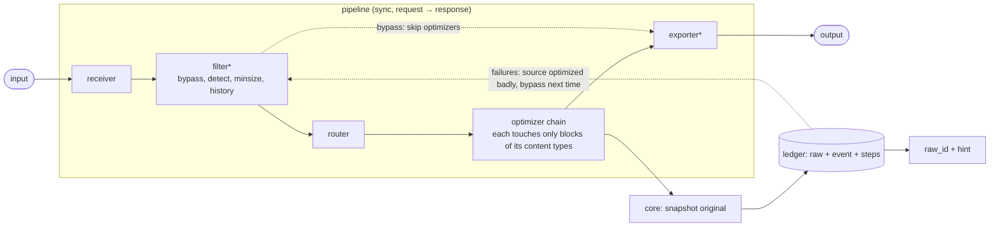

# Architecture

Gascoigne shrinks what LLM agents read (command output, tool results, API traffic) without
ever losing information. The design borrows from the OpenTelemetry Collector: typed pluggable
components built by factories, `type/name` ids, pipelines wired by YAML, an explicit registry.

Each `##` section stands alone; read only the one for the area you touch.

## Layout

```
component/  payload/  tokens/        public contracts: what component authors import
detect/  compress/  mcptool/         public libraries: content detection, text primitives, MCP tools
lazyre/                              package-level regexps compiled on first use (init stays ~1 ms)
version/                             release number + git commit from build info (CLI, MCP, health)
tokenizer/                           exact counts: o200k BPE in Go, Claude via count_tokens
cost/                                tokenizer families, prices, agent context model
receiver/  filter/  exporter/        components, one package each (OTel-contrib style)
extension/
optimizer/<family>/<name>optimizer   optimizers grouped by family (see Families)
internal/config  router  service     engine: YAML, routing, pipeline execution
internal/registry                    built-in component list (the "distribution")
cmd/gascoigne  configs/              CLI + embedded default config
```

- Receivers: stdin, exec, hook, mcp, mcp_proxy, httpproxy.
- Component packages import only public packages, so each can become its own module.
  `make imports` fails if a public package imports `internal/`.
- `tokenizer/` downloads the o200k vocabulary once and pins its hash.
- `cost/` relates tokenizer families to `tokens.Estimate` by a factor.

## Flow



| Kind | Contract | Role |
|---|---|---|
| receiver | `Run(ctx)`, gets `Settings.Pipeline` | turn input into `Payload`, return the result to the caller |
| filter | `Filter(ctx, p) (Decision, error)` | `Continue` or `Bypass`; may tag attrs |
| router | core, `router.Config` | first matching route picks the optimizer chain, else `default` |
| optimizer | `Optimize(ctx, p) error` | rewrite the payload in place, deterministically |
| exporter | `Export(ctx, p) error` | write or forward the result |
| extension | lifecycle only | shared services; `ledger` implements `component.Ledger` |

- Every component embeds the lifecycle `Start(ctx, Host)` / `Shutdown(ctx)` (`component.Nop` for none).
- Start order: extensions → exporters → optimizers → filters → receivers. Shutdown is reversed.
- Optimizers self-select by `Block.Type` through `payload.Rewrite`. The default router therefore
  sends every payload through one chain of all optimizers; routes only override per command or
  content.

## Payload

`payload.Payload{Blocks []Block{Kind, Text, Type}, Attrs map[string]string}`

- **Kind**, where a block came from: `cmd_output`, `tool_result`, `message`, `json`.
- **Type**, what it is: the detected content type, per block (see Content detection).
- **Well-known attrs**: `cmd`, `file`, `url`, `tool`, `mime`, `query`, `session`, `raw`, `raw_id`,
  `route`, `raw_tokens`, `out_tokens`.
- **`Key()`**: stable source identity (`file:` > `url:` > `cmd:` > `tool:`), used for failure history.

## Content detection: `family/dialect` (`detect/`, `filter/detectfilter`)

Every block gets a type `family/dialect` (`test/jest`, `build/tsc`, `pkg/pip`, `task/nx`). One
payload can mix types, and each part meets its own family engine.

### Dialect specs

Dialects are declarative `Spec`s in `detect/<family>.go`:
- command patterns: `program sub sub -flag`, the most specific wins; `CmdFunc` for flag values
- file globs and MIME types
- a sniffer with a priority: composite runners first, generic formats last

`Argv` unwraps wrappers and runners (`sudo`, `npx`, `uv run`, `bundle exec`, `python -m`).

### Evidence order

command → file/MIME → sniffing → `doc/text`.

A generic type from command, file or MIME is refined by a spec that lists it in `Refines` and
whose sniffer matches: `cat deploy.yaml` with manifests → `k8s/manifest`, a saved aws response →
`cloud/aws`.

### Helpers and rules

- `detect/matrix_test.go` requires a command example for every dialect with command patterns,
  and a content example (an eval fixture) for every dialect with a sniffer.
- `detect.Family` / `detect.Dialect` split a type.
- `detect.Command` names commands for stats; leading `cd`/`export` steps of a list are skipped.
- `edit_safe` (detect filter): config-sized data/k8s/cloud/infra files read from disk
  (`detect.ReadsFile`: cat/head/tail/sed) are typed `fs/code`, so a config read to be edited
  keeps its syntax.

## Families

One engine per family (`optimizer/<family>/<family>optimizer`); dialects tune it. Shared logic
lives in public libs so engines and composite families can reuse it. Families are what
`gain -by family` reports; `gain -by dialect` splits them.

### Family engines

| Family | Engine (lib) | Dialects |
|---|---|---|
| `test` | `compress/testreport`: go parsed, others via rules. Passes counted, noise and dependency frames dropped, failures and summaries kept | go, go-json, jest, vitest, bun, mocha, deno, pytest, cargo, rspec, maven, dotnet |
| `build` | `compress/watch`: watch output keeps the last cycle + earlier result lines. `compress/diag`: diagnostics grouped by file, identical ones across 3+ files folded, code frames capped (annotations kept), per-dialect noise/prefix rules | go, tsc, eslint, golangci, ruff, mypy, rustc, gcc, clang, javac, maven, dotnet, bundler, docker (RUN steps composed) |
| `pkg` | `compress/pkgnoise`: progress and downloads dropped, warnings folded by kind | npm, pnpm, yarn, bun, pip, uv, poetry, go-mod, cargo, os |
| `task` | sections; ok/cached ones collapse; failing ones via `compress/compose` | nx, turbo, make, just, gradle, compose, ci |
| `vcs` | git engine (see below) | git-status, git-log, git-diff, git-remote, git-blame, git-branch, gh-list, gh-view |
| `search` | grep engine: matches grouped by file (with or without line numbers), identical lines in a file merged (`3,9: text`, `2× text`); with a `query`, the per-file cap keeps the best BM25 matches | grep, rg, ag, git-grep |
| `fs` | ls engine: listings, tree, paths by directory, du largest, df real disks. cat: comments dropped, outlines (see Source files) | ls, tree, find, du, df, code |
| `table` | `compress/table`: parses boxed/aligned/ruled/fixed-width tables, hoists constants, cuts cells; rows via `compress/rows` (unhealthy statuses kept) | ps, ss, lsof, top, systemctl, docker, aligned, boxed |
| `data` | json: `compress/jsonx` crusher. YAML via jsonx when smaller, CSV via table, XML sibling runs sampled (failures kept), TOML lockfiles one line per entry | json, ndjson, yaml, csv, xml, toml |
| `log` | log engine (see below) | app, journal, syslog, docker, kubectl, access, cloudwatch, gcp, azure |
| `doc` | markdown/rst and man/help (see below) | markdown, rst, man, help (+ text: dedupe) |
| `web` | html: `compress/htmlx` → markdown (see below). http: transport headers and TLS chatter dropped, body by type | html, http |
| `db` | results via `compress/table`, EXPLAIN pruned to costly nodes, redis keys folded, mongo docs as JSON rows | psql, mysql, sqlite, explain, redis, mongosh, migrate |
| `k8s` | `compress/yamlx` prune rules (managedFields, last-applied, defaults); lists keep unhealthy items; describe/events/helm | get, manifest, describe, events, helm |
| `infra` | plans: refresh/progress folded, known-after-apply listed, count/for_each siblings "(like above)". ansible: quiet tasks counted, failures and recap kept | terraform, pulumi, ansible, cdk, helm-diff |
| `cloud` | JSON: pagination/metadata/etags pruned, envelopes unwrapped, items flattened so jsonx hoists leaves. YAML via yamlx; tables; s3 listings summarized | aws, aws-s3, gcp, azure |

### Engine details

**vcs (git engine)**
- Diffs: in-line edits as word diffs (`~[-old-]{+new+}`), only when every pair of a k:k block
  qualifies. Lockfiles and generated files fold to counts.
- Blocks removed and re-added verbatim elsewhere → `-… N lines moved to file:L` (`moves.go`).
- Log keeps `--stat` and name lists. Blame runs are grouped. Mirrored remote branches are dropped.
- gh lists go through `compress/table`.

**log**
- Lines become templates with counts; errors keep their context.
- Numeric outliers are kept: ≥ 10× the template's median at a place, for templates of 8+ lines.
- Container prefixes (kubectl `--prefix`, compose) are cut before and put back as labels
  (`A+B| `, with a legend).
- Structured cloud events → lines. Access logs → a traffic summary.

**doc**
- markdown/rst: badges, comments, layout HTML and TOCs dropped; code fences capped.
- Markdown over `max_tokens` keeps whole sections in this order: intro, strong BM25 matches of
  `query` (≥ half the best; versions like `go1.27` are terms), then page order. When whole
  sections use under half the budget, the first section left out keeps its head. Dropped
  sections leave their top-level headings + `… N lines omitted`.
- man/help: furniture and boilerplate dropped, dedented. Help with a `query`: option entries are
  scored by BM25 and those ≥ a third of the best are kept.

**web (html)**
- The root is the `<main>`/`<article>` with the most visible text, when that is ≥ half the page's
  and it neither holds articles nor is named a comment; else the whole page.
- Link-dense blocks (`dense.go`): mega-menus, tag clouds and "popular" lists written as plain lists of links are
  dropped like `<nav>`: a `ul`/`ol`/`div`/`section`/`dl`/`p`/`span` with at least 6 links, 85% of its text inside
  links and labels of 50 bytes on average, and only when the page keeps 1,500 bytes of text outside such blocks
  (a page that is itself a list of links, or whose links are long titles, keeps them). Benchmark
  (`html-bench.sh`, 181 articles): recall 98.3% → 98.8%, precision 59.3% → 64.5%.

### Core optimizers (in default chain order)

1. **`embedjson`** (`optimizer/core/embedjsonoptimizer`, first): JSON values with record arrays
   inside log/test/build/task/text blocks (`jsonx.Spans`) are crushed in place by jsonx; the text
   around them stays byte-exact.
2. *Family engines.*
3. **`dense`** (`optimizer/core/denseoptimizer`): long space-free lines (minified code, base64,
   data URIs) keep head/tail bytes around `…[N bytes dense]…`, once a block holds `min_total`
   such bytes. JSON lines and fs/code read from disk (file attr, `detect.ReadsFile`) are untouched.
4. **`paths`** (`optimizer/core/pathsoptimizer`): long path prefixes repeated in
   test/build/search/log/task blocks → `§1/file.go`, with a legend `[paths: §1=…]` on top of the
   first such block. Greedy by bytes saved, kept only when ≥ `min_saving` tokens, idempotent,
   never fs/data.
5. **`truncate`** (`optimizer/core/truncateoptimizer`): blocks still over `max_tokens` keep
   head/tail token budgets + `max_errors` error lines from the middle; long lines are cut.
   `skip`: fs/code, data, k8s, cloud.

### Shared libraries

- `compress/compose` sniffs a section and calls the test/build/pkg engine; used by `task` and
  docker builds.
- `compress/rows` samples records: errors, anomalies, change points, query matches, ends.
- `compress/probe` measures retention: error lines, artifacts (paths, URLs, hashes, UUIDs) and
  `key=number` pairs of an original that are still readable in the output (regrouping, path
  legends and short hashes count as kept).
  - `gascoigne eval` shows lost counts per case and pins them, with out tokens, in
    `testdata/eval/baseline.tsv`; any change fails until `-update`.
  - `gascoigne probe` runs it over ledger originals vs stored outputs (proxy folds skipped), per
    family + worst runs.

### JSON arrays (`compress/jsonx`)

Used by `optimizer/data/jsonoptimizer`, cloud, data and web.

1. **Small arrays are never sampled**: < `min_items`, < `min_tokens`, or ≤ `max_items`.
2. **Lossless first**: similar objects become a table (`_cols/_rows`), with constant columns in
   `_same` and shared prefixes/suffixes in `_affix`. Items with nested objects are also tried
   flattened to dotted columns (`jsonx.Flatten`); the smaller table wins. Kept when it saves
   ≥ `lossless_min_saving` and fits `lossless_max_tokens`.
3. **Else scored sampling** to ~`max_items`, in priority order:
   - errors, always: error fields, bad statuses, 4xx/5xx, keys or enum values few items have
   - by score: anomalies (> `anomaly_std` σ), change points (numeric jumps, enum flips), BM25
     matches of the `query` attr (`-attr query=...`, MCP `query` param)
   - head/tail shares, then an even sample
   - identical items collapse; gaps become `… N items omitted`

## MCP

**`gascoigne mcp`**, a stdio server with these tools:

| Tool | Does |
|---|---|
| `fetch` | web pages → markdown, API JSON compressed; http/https only, timeout, size cap. The cheap way to read web data |
| `compress` | any text, with optional `cmd`/`file` hints |
| `show {file, symbol?}` | one definition with doc comment and line numbers, or the outline without a symbol. Also `gascoigne show file[:symbol]`; `mcptool.Show` on `compress/symbols` (Go parser, Python indent, C-like braces) |
| `retrieve id` | the original; optional `lines`/`grep`/`query` read a part (not a failure). A full read marks the source as badly optimized |
| `stats` | savings (see Ledger → Reports) |

**`gascoigne mcp-proxy -- <server cmd>`** mirrors a downstream server's tools, optimizes their text
results and adds `gascoigne_retrieve`. Non-text content passes untouched.
- `compact_tools` drops redundant schema keys.
- `max_tools` > 0 (off by default) hides more tools than that behind `search_tools` (BM25 over
  names and descriptions, top 5 with schemas) and `call_tool`, for agents without native tool
  search.

- Lazy tools: the proxy can offer chosen tools of a server on request only (`WithLazy`, tool names by
  server id, read at start: a session's tool list never changes, so the prompt cache holds). The rest
  stay listed; `search_tools` and `call_tool` reach the lazy ones, and the description of `search_tools`
  names them (sorted, at most 40, then "and N more"), so the agent knows they exist and asks for them.
  No tool is lazy when the server has a tool of those names; `max_tools` (everything lazy) wins over a
  choice; names the server lacks change nothing. On a 30-tool fixture with 25 lazy, the list falls from
  about 5.2k to 1.2k tokens (`TestLazyToolsEval`).
- Stats: when the agent lists tools, the proxy records the definition size of each tool it
  showed (as the agent receives it, schemas compacted; rows flagged lazy hold what the lazy tools would cost) under the downstream server's id and counts every call
  (`ledger` `tool_stats`). The id is the name the server reports plus a short hash of its command line
  (`serverID`), so two configurations of one server binary stay apart; only the hash is kept, since
  arguments can hold keys. It is not the agent's config key.

MCP pipelines have no exporters: stdout is the protocol channel.

## LLM API proxy (`receiver/httpproxyreceiver`, `cmd/gascoigne/llmproxy.go`)

### Serving

- Mounted in the background server under `/v1/`: one process, one port, base URL
  `http://127.0.0.1:7878`.
- The receiver is an `http.Handler` (`Run` is a no-op), built from the user's config
  (`receivers.httpproxy`, pipeline `proxy` via `optimizerService`). Payloads run one at a time
  under the warm services' lock.
- On a new build the server waits until no proxied request is in flight (`waitIdle`, ≤ 10 min)
  before restarting.

### APIs

| API | Matched by | Notes |
|---|---|---|
| Anthropic `/v1/messages*` | path, or `anthropic-version`/`x-api-key` headers | |
| OpenAI `/chat/completions`, `/responses` | path | |
| Gemini `/v1beta/models/<m>:generateContent\|:streamGenerateContent` | path (also mounted at `/v1beta/`), or `x-goog-api-key` | `functionResponse.response.output\|content` answers the call with its id, else the oldest open call of its name; model from the path |

- **No session id.** None of the APIs carries the agent's session, so proxy events and `usage` rows
  have an empty `session` (agent from the User-Agent, model from the body). Per-session reports
  (`gain -session`, the dashboard session filter) leave the proxy's runs out; they show as the "-"
  group, mixed with command-line runs started without `-session`. Fixing it needs an id from the
  agent (a header it can be told to send); none is known today.
- Other paths and every header pass through. `anthropic-beta` carries the OAuth capability, so a
  claude.ai login keeps working.
- Responses stream through (`FlushInterval -1`).
- Any parse problem → the body is forwarded unchanged. `X-Gascoigne-Raw: 1` → untouched.

### Tool results

- One payload per tool result, with attrs from the matching call (`attrsOf`):
  - built-in tools are described as the shell command that prints the same thing: Read →
    `cat <path>` (or `sed -n <offset>,$p` for slices), Grep → `rg -n|-l|-c`, Glob/list → `find`
  - `query`/`prompt` → query attr; url; tool; model from the body; agent from the User-Agent
- `skip` tools, `is_error` results and hinted output stay untouched.
- Read's `N\t` prefixes are split off, the text is optimized like `cat`, and kept lines get their
  original numbers back (`renumber`).
- **Prompt cache**: results are cached by content hash (LRU `cache_entries`), so every later
  request sends the same bytes. Optimizers are deterministic, so a restart recomputes them.

### Fold (`fold.go`, per request)

After shortening, runs of ≥ `fold_min_lines` lines / `fold_min_chars` bytes that an earlier
result of the same request shows become one pointer: `[↑ L13-18 = L10-15 of earlier Read a.go]`.
Read lines match by text, with a uniform line-number shift.
- Recomputed for each request: a result depends only on earlier ones, so it is prefix-stable and
  leaves no dangling pointers when clients clear old results.
- The original is saved via `SaveRaw` (content-addressed id) + an event (route `fold`); savings
  are memoized. Needs `ledger` (looked up in `Start`).

### Other request parts

- **Tool schemas** (`tools.go`, `compact_tools`, `compress/schema`): titles restating names and
  `$schema`/`$id` are dropped in every API's shape; one event per distinct tool set (route `tools`).
- **Instructions** (`prompts.go`): system prompts, `<system-reminder>`s in user text, chat/responses
  system/developer messages and `instructions`, Gemini `systemInstruction`. Each distinct block
  records one unchanged event (route `prompt`, command `system prompt`/`CLAUDE.md`/`skills`/
  `reminder`), so `gain -by command` shows what instruction text costs.
  - The text is kept as the run's original (`gascoigne raw <id>`) and pruned with `raw_ttl` like
    other originals.
  - The dashboard shows only its size: `/api/raw|out` answer 403 for `prompt:` keys.
- **Skills** (`skills.go`): invoked skill bodies (user text starting
  `Base directory for this skill:`) are recorded once per body with their text kept (route
  `skill`, command `skill <name>`).
  - With `skill_code_lines`, longer code blocks keep their head plus
    `… N more lines: gascoigne raw <id> -lines a-b`. HTML comments go.
  - Measured: a 30k-token bundled skill is prose and tables (−0.3%).
- **Images** (`images.go`, `max_image_pixels`, 0 = off): base64 PNG/JPEG blocks in tool results
  above the cap are box-downscaled (deterministic, cached by hash). The original is saved (`raw`)
  and the event counted in image tokens (pixels/750, route `image`).

### Usage metering (`usage.go`)

- 2xx response bodies pass through a meter: SSE `data:` lines mentioning usage are decoded, JSON
  bodies ≤ 8 MB at the end.
- Per API reader, fields are max-merged across events; cached input is split out (OpenAI and
  Gemini count it in input).
- On close, one `component.Usage` goes to the ledger's optional `component.UsageRecorder`
  (table `usage`, no session).
- `gain` section "api usage", priced by `cost.Lookup`; JSON `api_usage`; `reset` filters apply. Each row also
  carries the mean and peak context of a request (input + cache read + cache write: the conversation it
  re-read), and `UsageDays` sums per UTC day (`gain` table "api requests by day" from two days on, JSON
  `api_days`, the dashboard panels "API requests by day|model" over `GET /api/usage`). No session id: see above.

### Registration with agents

The server is started first (`serverUp`). Then:

| Agent | Proxied when | How |
|---|---|---|
| claude (`claudeProxyVar`) | `ANTHROPIC_API_KEY`/`ANTHROPIC_AUTH_TOKEN`, or `GASCOIGNE_PROXY=on`. A claude.ai login stays direct (terms of use) | `ANTHROPIC_BASE_URL` |
| claude on Bedrock | `AWS_BEARER_TOKEN_BEDROCK` | `ANTHROPIC_BEDROCK_BASE_URL=…/bedrock/<region>`; route `bedrock.go`, region validated, upstream template `bedrock`. SigV4 stays direct: it signs the body |
| codex | `OPENAI_API_KEY` | a `model_providers.gascoigne` (`wire_api=responses`) |
| opencode | each provider only with its API key | provider `baseURL`s |
| gemini | `GEMINI_API_KEY`. A Google login stays direct | `GOOGLE_GEMINI_BASE_URL` |

- Never on Vertex or Foundry, nor over a user's own base URL.
- `install -proxy` refuses in the same cases. `install -proxy claude` writes the env for good
  (SessionStart starts the server); unwrap removes it.

### Replay (`cmd/gascoigne/replay.go`)

`gascoigne replay` rebuilds Claude Code transcripts (`~/.claude/projects`, newest first) into one
request per model turn after tool results:
- lines of one role are merged, sidechains skipped, compaction restarts the conversation
- requests go through `llmProxy` against an in-process upstream with a throwaway ledger
- reports: tokens per tool; message input cost as sent and as forwarded (`cost` prices: the
  prefix the previous request sent identically is read from the cache, the rest written); how
  many re-sent messages the proxy forwarded byte-identical (canonical JSON)

## Source files (`optimizer/fs/catoptimizer`)

Agents edit by exact text, so source is shrunk only by dropping whole lines. Kept lines are
byte-exact: indentation and trailing comments are untouched, so Python stays valid as far as shown.

**Gap markers.** Each gap is one marker in the file's comment syntax that names the original
lines: `// … comments L12-30`, `# … docstring L3-9`, `// … L50-89` for a body (`N lines` instead
of numbers for `tail`/`sed`). An agent edits within kept runs and reads a gap back by range
(`sed -n 12,30p f`: small, passes untouched) or the whole file (`cat_mode=full`, `gascoigne raw`).

**Modes** (chosen by size):
- **clean** (800–4000 tokens): comment runs go.
  - A run right above code keeps its first line with words (the doc summary). So does a run one
    blank line above code at its indent, unless it comes before any code.
  - Python docstrings after `def`/`class` keep their summary line.
  - Runs cheaper than a marker stay, as do directives (`//go:`, `# type:`, `noqa`, shebang,
    coding, eslint/ts pragmas).
  - Lines inside multi-line strings (backticks, triple quotes, heredocs) are never taken for
    comments.
- **outline** (≥ 4000 tokens): clean, plus function bodies elided; signatures and closing braces
  kept as they are.

**Scope.**
- Language-agnostic: comment syntax per extension (`//` + `/* */`, `#`, `--`, `;`, `%`), else by
  family (`detect.Lang`). Unknown languages are left alone.
- Only `cat`/`head`/`tail` output and MCP `compress` are touched, never an agent's own
  file-read tool.

## Agents (`cmd/gascoigne/agents.go`, `hook.go`)

### Commands

| Command | Does |
|---|---|
| `wrap <agent> [args]` | starts the agent with gascoigne registered for that run only (no config files touched), `GASCOIGNE_AGENT`/`GASCOIGNE_SESSION` set |
| `install [-g] [agent...]` | writes the registering config into project files (`-g`: user files). Existing gascoigne entries replaced, JSON merged, backup kept (`install.go`) |
| `wrap -print <agent>` | prints that config |
| `unwrap [agent...]` | (default: all) removes exactly those entries from user and project configs: claude settings + `.mcp.json` + `claude mcp remove`, cursor hooks/mcp JSON, codex `config.toml` tables, pi extension. Other keys keep their order; the original is saved as `<file>.gascoigne-bak`; unparsable files are reported, not rewritten |
| `uninstall [-y]` | (`uninstall.go`) unwrap all + stop the server + delete gascoigne's config/data/cache/state dirs, an outside ledger's files (never its dir) and the binary; asks first |

### Per agent

| Agent | Per run | How shell output is optimized |
|---|---|---|
| claude | `--mcp-config` + `--settings`. Denies Grep/Glob (searches run through Bash) and WebFetch (pages go through gascoigne fetch); Read stays (Edit needs it); WebSearch stays | PreToolUse rewrites the command to `gascoigne exec -- <cmd>`. No permission decision: rules see the wrapped command |
| codex | `-c mcp_servers…` + `-c hooks.PostToolUse…` | PostToolUse runs the output through pipeline `hook` and replaces the result (`decision: block`); codex rewrites a command only by approving it. Trust the hook once with `/hooks` |
| pi | `--extension` (written to the user cache dir) | `tool_call` rewrites the bash command; no MCP |
| gemini | env `GEMINI_CLI_SYSTEM_SETTINGS_PATH` → run settings in the cache dir (real system settings merged in, user/project stdio servers proxied) | BeforeTool `hookSpecificOutput.tool_input` rewrites `run_shell_command` (no decision: approval stays); SessionStart adds the guide (`gemini.go`) |
| opencode | env `OPENCODE_CONFIG_DIR` (plugin in the cache dir) + `OPENCODE_CONFIG_CONTENT` (`mcp`, proxied servers, `instructions` guide unless the user has some) | plugin `tool.execute.before` rewrites `output.args.command` via `gascoigne hook opencode` (`opencode.go`) |
| cursor | — (config files only: `-print`) | preToolUse `updated_input`, `permission: allow` (shell approval stays with `beforeShellExecution`) |

### Usage guide (`guide.go`)

claude: a SessionStart hook (`additionalContext`). codex: `-c developer_instructions` per run, or
an `AGENTS.md` marked block. cursor: a project rule. pi: an `AGENTS.md` block. Unwrap removes them.

`guide(rewrites, mcp)` says only what the agent has: rewrite advice where commands are rewritten
(not codex), the fetch/compress/show/retrieve tools where gascoigne's MCP server is registered
(not pi; it gets the `gascoigne show` / `gascoigne raw` CLI forms). Codex and pi share the project
`AGENTS.md` block: the one installed last stays.

Level: `$GASCOIGNE_GUIDE`, else `guide` in `prefs.json` (state dir, `prefs.go`; set with
`install -guide`), else `full`. `short` keeps the path-id and hint lines; `off` injects nothing
and the next `install` removes the AGENTS.md block and cursor rule. Unknown values mean full.
The file is not `config.yaml`: a key there needs a change in `internal/config`.

### Other MCP servers (`proxy.go`)

Stdio servers start through `gascoigne mcp-proxy -- <cmd>`; remote servers stay direct.
- `wrap` passes same-named copies: claude `--mcp-config` beats configured scopes for the run
  (approved/enabled servers only); codex uses `-c` overrides.
- `install` rewrites `.mcp.json`, `~/.claude.json`, codex tables and cursor `mcp.json`.
- `unwrap` restores the original commands from the kept args.

### Hooks

- Hooks call `gascoigne hook <agent>`, which never fails the tool call: bad input → no answer →
  call unchanged.
- **After-the-fact replacement** (`posthook.go`), for results the command rewrite cannot reach:
  - claude PostToolUse `updatedToolOutput` in the tool's shape (Bash stdout, Grep content mode, `mcp__*`)
  - codex PostToolUse `decision: block` + `reason` (`^Bash$|^mcp__.*`)
  - gemini AfterTool `decision: deny` + `reason` (shell, `mcp_*`)
  - skipped: hinted output (`hintRe`) and gascoigne's own MCP tools. Read is never replaced
    (Claude numbers its lines).
- **Permission rules** (`rules.go`): `install claude` adds deny rules like wrap (Grep, Glob,
  WebFetch) and, by the saved level (`install -permissions none|local|all`, `prefs.json`), allow
  rules for gascoigne's own tools: `local` = retrieve, show, stats, compress (read-only);
  `all` adds fetch (reaches the network); `none` (default) adds nothing. Added rules are recorded
  per settings file in `$XDG_STATE_HOME/gascoigne/denies.json` / `allows.json`; unwrap removes only
  recorded ones, a changed level drops the old ones first, a rule the user already had is never
  taken.
- **Install manifest and sync** (`installs.go`): `install` records each agent, scope, project dir,
  how the config calls gascoigne, `-proxy` and a `registration` number in `installs.json` (state
  dir); `unwrap` drops them. `registrationVersion` is bumped whenever what install writes (hooks,
  matchers, guide, rules) changes. On SessionStart/UserPromptSubmit hooks, when `prefs.autosync`
  is `on` (`install -autosync on`) and `$GASCOIGNE_AUTOSYNC` is not `off`, user-scope installs with
  an older number are written again (`agent.sync`, else `add`; claude: settings only, never
  `~/.claude.json` which a running Claude Code rewrites), under `installs.lock`, never failing the
  hook; SessionStart tells the agent to restart. Project installs are never touched by hooks:
  `gascoigne upgrade` does this project's and the user's now. Not decided = nothing is synced.
- **Release notice** (`release.go`): the background server (`watchRelease`, started by `server run`)
  reads `<site>latest.json` (`{"id":"0.3.0","released":"…","page":"releases/0.3.0/"}`) once a day
  (`checkRelease`; a failure is retried in an hour, the last good answer stays) and saves it as
  `release.json` in the state dir. A claude SessionStart hook (`releaseNudge`: startup or resume,
  not compact or clear) opens the page once per release when `version.Newer(id, version.Number)`
  (`prefs.seen_release`) and adds a note. Hooks never use the network. The id must be a plain
  `X.Y.Z`; the page must stay on the site's host and path; the body is cut at 4 KB; the request has
  no query, cookie or version. Off: `GASCOIGNE_RELEASE_CHECK=off`, `prefs.release_check`, or no server.
  The setup question is optional (`on` until answered off). `doctor` and `upgrade` show a newer
  release. The website side is the `gascoigne-webpage` repo: `latest.json` plus `releases/<id>/`.
- **Weekly MCP review** (`mcpnudge.go`): `mcpNudge` runs after `setupNudge` and `releaseNudge` in a claude
  SessionStart (startup or resume). It returns nothing when either of them opened a page (one page per
  start; the week is not used up), on compact or clear, with `GASCOIGNE_MCP_REVIEW=off`,
  `prefs.mcp_review: off` or `GASCOIGNE_SERVER=off`, or less than 7 days after `prefs.last_mcp_review`
  (read before any request). Then it asks the running server (`GET /api/mcp`, 1 s timeout, never starts
  it) and, when `reviewWorth` finds at least `mcpNudgeTokens` (1500) per request in unused proxied
  servers and idle tools not yet chosen to load on request, records the week, opens `/mcp` (not under
  `CI`) and adds one note. Direct servers and servers seen under a week never count. The setup question
  `mcp_review` is optional and on by default, like `release`.
- **Legacy installs** (`installs.go` `legacyInstalls`): installs made before `installs.json` existed
  (the first release) are found by their config: the user-level file, and this project's, holding
  `hook <agent>` while nothing records it. `readInstalls` returns them as registration 0, so the
  update question, `upgrade` and `doctor` treat them as stale; recording an install (or `upgrade`)
  makes them regular entries.
- **Decisions** (`setup.go`, `setup.html`): changes beyond gascoigne's own files wait for the
  user. Open questions = unset `allow` / `autosync` in `prefs.json`. `install` (end) and a claude
  SessionStart hook (source startup or resume, not compact or clear; at most every ten minutes,
  `prefs.asked_at`; again at each new session until every question is answered; recorded installs
  only) open `http://<server>/setup?token=…` with `openBrowser` (not under `CI`, not without a
  display; `GASCOIGNE_SERVER=off` falls back to the one-line notice). `GET /api/setup` and
  `POST /api/setup {token, answers}` need the token from `setup.json` (random, 24h, mode 0600,
  deleted after one answer; constant-time compare); only the offered ids and values are accepted;
  the usual loopback-Host and cross-origin checks apply. An answer saves the prefs and writes
  user-scope installs again; project installs are listed ("run gascoigne install there").
  `gascoigne setup [-y] [-all] [-t]` opens the page, or asks the same in the terminal. The page
  (`setup.html`) first shows what was found (`buildSetupView`: each install connected or older, agents
  on PATH not connected or declined, the version), then the questions in sections by `decision.Group`
  (permissions, updates, agents), each option with a sentence saying what it does (`option.Detail`);
  experimental features are optional questions (`decision.Optional`, always answered, never nag), folded
  on the page, each with an example, how it works and its impact (`decision.Example/How/Impact`,
  also printed by the terminal form): the
  choice is `prefs.experimental`, which `experimentalOn` reads next to `$GASCOIGNE_EXPERIMENTAL` and
  the config's list; `setup -experimental` asks only those, and a test keeps `experiments` in step with
  the commands marked experimental in `help.go`;
  a save bar says how many answers will be saved, and the result lists what was done.
  New agents: an agent on PATH with no recorded install and not declined gets a question
  (`integrate:<agent>`, default yes). It is only signaled: a SessionStart note and the page (until answered, like any question); yes runs the user-level install and records it, no is remembered
  (`prefs.declined`; `setup -all` can reverse it). Nothing is installed without the answer.
- **Doctor, upgrade and skills** (`doctor.go`, `upgrade.go`, `claudeskills.go`): `doctor` only
  reports: binary on PATH, server, guide level, open questions and, per recorded install, whether
  the agent's config (`configOf`) still holds `hook <agent>` and the registration is current. Each
  problem carries a `fix`, which `gascoigne upgrade [-n]` runs: it is the one place for what a new
  version needs (stale or lost hooks, rules and commands of user installs and this project's; other
  projects are named; `config.yaml` moved onto the template via `writeUpgrade`, `.bak` kept; open
  choices handed to `offerSetup`). `install claude` also writes the skills `gascoigne-stats` and
  `gascoigne-doctor` (`disable-model-invocation`, so their descriptions are not sent with requests;
  marked with `skillMarker`, so `unwrap` removes only ours).
- **Identity**: rewritten commands carry `-agent <name>` and `-session <hook session_id>` when
  `GASCOIGNE_AGENT`/`GASCOIGNE_SESSION` are unset (installed hooks). `wrap` sets the env, so its
  commands stay short (`execPrefix` in `hook.go`).

### Coverage (which tool results reach the optimizer)

| Tool | claude | codex | gemini | opencode / pi / cursor |
|---|---|---|---|---|
| shell | rewrite (PreToolUse) | PostToolUse replaces result | rewrite (BeforeTool), AfterTool replaces what the rewrite missed | rewrite before the call |
| Grep, Glob | denied → `rg`/`find` through the shell | shell only | shell only | shell only |
| WebFetch | denied → gascoigne `fetch` (MCP) | no hook | no hook | no hook |
| Read | not replaced (Edit needs the line numbers); the LLM proxy shortens it when on | no hook | no hook | no hook |
| MCP tools | PostToolUse `mcp__*`, plus `mcp-proxy` | PostToolUse `mcp__*` | AfterTool `mcp_*` | `mcp-proxy` only |
| Subagents | hooks run there too: gascoigne's own PreToolUse and PostToolUse show in subagent transcripts (13 files, 2026-10-12) | n/a | n/a | n/a |

Cursor has the preToolUse hook only: no result replacement is known. A status line can show the
savings: `gascoigne gain -oneline -since 1d` (`docs/agents.md`).

### Resume snapshot (`continuity.go`, experimental: `continuity`)

Claude SessionStart with `source` compact or resume adds a snapshot of the transcript to the
guide's context: last request, open TodoWrite items, files edited (newest first, 15), recent
failed Bash commands (3, `NAME_KEY=` / bearer values cut). Only the agent's own calls are read,
never tool output; subagent lines are skipped; capped near 2 KB and deterministic. It also names the
outputs gascoigne shortened in this session (up to 6, one per command, latest raw id, at least 200 tokens
saved; `ledger.RecentRuns` by the hook's session id, the default ledger path, command and id only) so that the
agent reads them with `gascoigne raw <id> -grep` instead of running the command again. Needs no new
registration (SessionStart is already installed). Gemini's `PreCompress` has no equivalent yet.

### Command rewriting rules (`hook.go`)

- **Wrapped**: every command of a `&&`/`;` list, except builtins, quiet, interactive and REPL
  commands (`passthrough`; unknown programs are detected by content).
- **Kept pipes**: trailing `| head` / `| tail` stages (they then cut optimized text). Before
  `head`, exec gets `-attr hint=top`: the stdout exporter prints the hint first so the cut keeps
  it. Other pipes stay as they are, since other filters would search the optimized text.
- **Left as they are**:
  - lines with loops, conditionals or `{ }` groups
  - redirects (except `2>&1`), subshells, `||`, background runs
  - commands that run gascoigne itself
  - commands that run until stopped (`-f`/`--follow`, `--watch`, `dev`, `serve`, `start`, `up`,
    plain `vite`), since exec shows output only when the command exits
- **Watch mode exception**: build tools in watch mode (`watched`) run as `exec -watch`, which
  processes each cycle when `watch.End` sees its result line; background runs included.

## Full-payload guarantee

Lives in core (`service/pipeline.go`), not in optimizers:

1. Before optimizers run, core snapshots the payload.
2. Output saving fewer than `minSaving` (20) tokens, the cost of the retrieve hint, → the original
   is kept, outcome unchanged. If the output differs, the original goes to the ledger first,
   `raw_id` is set, and stdout gets the hint
   `[gascoigne: optimized 4120→610 tokens · full: gascoigne raw <id>]`.
3. Ledger save fails → the original is returned. Optimizer errors → the original is returned and
   a failure recorded.
4. Up-front opt-out: the `bypass` filter (`-raw`, `GASCOIGNE_RAW=1`, attr `raw=true`).
5. Retrieval: `gascoigne raw <id>`, MCP `retrieve` / `gascoigne_retrieve` (later: HTTP proxy
   `GET /raw/<id>`).

## Ledger (gorm + sqlite, `extension/ledger`)

### Storage

- Pure-Go driver (`gormlite`), WAL mode, busy timeout 5 s.
- Gorm models in `models.go`; `AutoMigrate` on Start adds new tables, columns and indexes.
  Renames, drops or type changes need an explicit migration step: ask first.

| Table | Holds |
|---|---|
| `events` | every trip: route, tokens, outcome, `session`, `command`, `reason`, bypassing `filter` |
| `steps` | per event, each optimizer that changed tokens: optimizer, family, tokens before/after |
| `raw` | originals, gzip-compressed (plain JSON rows from before still read); TTL-pruned. `gascoigne flush [-older]` / `POST /api/flush` delete and VACUUM |
| `failures` | per-key failure count |
| `tool_stats` | per day, agent, MCP server, tool: definition tokens (last listing that day) and calls. Written by `mcp-proxy` through the optional `mcptool.ToolStatRecorder` (not a `component/` contract); pruned at `stats_ttl` (14 d). Direct servers' calls are the hook's events whose command is the tool name |
| `usage` | per proxied API request: agent, model, input, cache read/write and output tokens as the provider billed them |

**Raw ids** are sha256 prefixes of the original's text, attrs aside: the same output from two
sessions is stored once. 8 hex digits, unless that prefix holds another text (then 12, 16, 64):
~7 fewer tokens in every hint, still content-addressed and unique.

**Source keys** over 200 bytes (whole command lines, heredocs) are stored as a 160-byte prefix +
`…#<hash>` (`keys.go` `storedKey`, applied by every method). Ledgers from before were converted
once (`PRAGMA user_version` 1) and vacuumed: 22 MB → 6 MB on a real one, mostly the key index.

### Identity and sessions

- `-session ID`, `-agent NAME`, `-model NAME` on any command (env `GASCOIGNE_SESSION`,
  `GASCOIGNE_AGENT`, `GASCOIGNE_MODEL`) tag events.
- MCP: agent defaults to the client's name (clientInfo); model only when given. Session: explicit
  `-session`, else the MCP transport session id, else one id per server run.
- Hooks record the model from the tail of `transcript_path` (`transcriptModel`, `-model` in the
  rewrite).
- `events.command` is normalized via `detect.Command`, else MCP tool + URL host.

### Lessons: `gascoigne learn` (`learn.go`, experimental)

Reads the newest runs (default 30 days, 5000) and finds two habits, each in at least two
sessions: `rerun` (the same key shortened with a hint three or more times in a session: the agent
runs the command again instead of `gascoigne raw <id> -grep`) and `big` (output of 1500+ tokens
that no optimizer shortened). Proposed lines are deterministic, at most 10, printed by default;
`-apply` writes a marked block (`<!-- gascoigne:learned:start/end -->`) to `CLAUDE.local.md` or
`-target`, `-remove` takes it out (the file goes if nothing else is in it). Proxy folds do not
count. Nothing is written otherwise.

### Reports: `gascoigne gain`

| Command | Shows |
|---|---|
| `gain` | overview: totals line; last 7 days trend (quiet days shown); by agent; by model (once recorded); by outcome (optimized/unchanged/bypassed/error, with tokens and share of input); by command (`go test`, `git log`, `fetch go.dev`); by optimizer (with family); skipped / failed / unchanged with reasons; count of failing sources |
| `gain -by day\|week\|month` | trend, oldest first, bars scaled to the best period |
| `gain -by agent\|model\|session\|command\|optimizer\|family\|outcome\|reason\|route` | one grouping |
| `gain -failures` | sources that bypass optimization after going bad |
| filters, any view | `-session`, `-agent`, `-model`, `-since 7d\|4w\|6mo\|24h` (combine freely); also `-all`, `-json` |

- The overview ends with `estimates` (`Overview.Estimates`, JSON `estimates`, MCP `stats`): what
  is estimated and how (tokens.Estimate error, cost factors and rereads, image pixels/750, tool
  sets counted once), so totals are not read as billing.
- Terminal output (`cmd/gascoigne/render.go`): human token counts, savings/share bars, colors by
  saved % (green ≥ 60, yellow ≥ 30, red). `-color auto|always|never`; auto honors `NO_COLOR` and
  TTY detection.
- MCP `stats {by?, session?, format?: json}` stays plain text (no ANSI or bars: they cost the
  agent tokens) and defaults to the overview of the calling session (`session: all` for every
  session).

### Cost (`cost/`, `mcptool.BuildCosts`, docs/cost.md)

saved tokens × tokenizer factor × (first read + rereads), per agent and model:
- tokenizer factor: claude 1.58 (measured from transcripts), legacy 1.25, gemini 0.79, o200k 1
- first read: cache write or input price; then `rereads` (measured median 110 later requests in
  context) × cache read price; 0.8% misses at write price
- runs without a model use `cost.AgentModels` (marked assumed)
- prices are the providers' official list prices (`cost.PriceSources`, `cost.PricesChecked`);
  `Costs.Pricing` carries that basis into the overview JSON, `estimates` and the dashboard

### Skip reasons

Every run that is not optimized records a factual reason (`events.reason`), shown per component
and command in the overview's SKIPPED / FAILED / UNCHANGED sections and in JSON. `gain -by reason`
lists these groups alone.

| Source | Example reason |
|---|---|
| bypass | `raw requested: attr raw=true` or `env GASCOIGNE_RAW=1` |
| minsize | `45 tokens < min_tokens 200` |
| history | `<key> failed N× (max_failures M), last: <reason> at <time>; reset: gascoigne forget <key>` |
| optimizer error | first line of the error |
| ledger failure | `save original: …` |
| unchanged | optimizer note (e.g. `cat: 590 tokens < clean_min_tokens 800`) or `no optimizer changed it`, plus the detected types (which content lacks an optimizer) |

Filters and no-op optimizers explain themselves via the `skip_reason` attr (`payload.AttrSkip`).

### Failure history

Signals → `MarkFailure(key, reason)`: optimizer error (`error`), agent fetched the raw original
(`raw_requested`), `gascoigne fail` (`manual`). The `history` filter bypasses a key once
`count >= max_failures`; `gascoigne forget <key>` resets it.

### Background server (`cmd/gascoigne/server.go`)

**Lifecycle**
- One per user on `$GASCOIGNE_SERVER_ADDR` (default `127.0.0.1:7878`; the port is the lock).
- Started detached (setsid, log in the user cache dir) when `/api/health` does not answer, by
  commands with `common.server` set (`exec`, `serve` for mcp/mcp-proxy, the codex hook's
  `optimize`) and by `wrap`.
- Health reports pid, build (hash of binary path + size + mtime), binary mtime and ledger path.
  An older build is replaced (stop + spawn), a newer one kept, another ledger left alone.
- The server stats its binary every 2 s. A new build seen twice in a row → shut down, close the
  ledger, spawn the new binary (`watchBinary`).
- **Idle exit** (`idle.go`): requests in flight and the last one's end are tracked (`/api/health`
  excluded; an open stream counts). After `-idle`/`GASCOIGNE_SERVER_IDLE` (30m, 0 never) the
  server shuts down. Commands start it again (`ensureServer`); agents' UserPromptSubmit hooks
  (claude, codex; opencode `chat.message`) bring it back before the next API request reaches the
  proxy.
- Commands: `server run|start|stop|status`; `dashboard` = `server start -open` (opens a browser
  unless there is no display; `-open=false`); `GASCOIGNE_SERVER=off` disables it.

**Server mode** (`remote.go`): `exec`, `run` and the codex hook (`common.useServer`) build only
their pipeline's receivers and exporters (`service.Options.Remote`) and POST the payload to
`/api/optimize`.
- There a warm service per config hash (defaults + user file + overrides; receivers and exporters
  stripped; ≤ 8 kept; one payload at a time) runs `Pipeline.Optimize`.
- Same build and ledger path required (409 otherwise). Refused, 409 or a broken server → the full
  pipeline is built locally for that payload (which also starts or replaces the server). Pipeline
  errors (422) are returned.
- Runs with other `GASCOIGNE_*` env (raw, cat mode, ledger) stay local. A spawned server drops the
  spawner's `GASCOIGNE_*` env except ledger/config/addr.
- Package-level patterns use `lazyre` (`TestPatternsCompile` runs `lazyre.Check`), so a served
  run never compiles them.

**Reset**: `gascoigne reset` / `POST /api/reset` → `ledger.Reset`: events + steps by filters
(flags only, never env); `-all` also raw and failures, with no filters.

### Context report (`context.go`, `context.html`)

`GET /context` over `GET /api/context?since=24h|7d|…` (default 14d, 1 hour to 90 days) = `loadContext(~/.claude/projects, period)`:
the newest transcripts (at most 300) written within the period, read once each, each cut to the turns inside it. Not the ledger: only transcripts carry a
session id and per-turn usage (the LLM proxy has no session).
- `readSession`: assistant lines of the main conversation (sidechains and synthetic messages skipped; a message
  streamed twice counts once, the last usage wins); context = input + cache read + cache write; a drop below
  `compactDrop` (60%) of the previous turn, from `minContext` (60k) up, is a compaction or `/clear`.
  Model names are normalized (`anthropic/claude-sonnet-5.5` → `claude-sonnet-5-5`) before `cost.Lookup`.
- Cost at list prices, 5-minute cache writes. Buckets split the cost by the context of the request.
- `simulate(turns, limit, floor, model)` re-prices a session as if compacted when its context passed `limit`
  (150k, 250k, 400k; a conversation restarts at `floor`, the smallest context of the whole session even before the
  period, and a limit it could not shrink below is skipped): reads for what was cached, writes for what is new, one full-context request plus a
  12k summary per compaction, growth as it was; a real reset is followed, not compacted twice. The same model
  prices the baseline, so thresholds compare with each other (within 5% of the actual cost on a real
  month). More compactions are not always cheaper.
- Cache rewrites (`rewrites`): a turn whose cache read fell short of the previous request's context by over 5%
  (and 2k tokens) rewrote the difference, priced at write minus read. Cause from the transcript's timestamps:
  compaction, a pause over an hour, a pause of 5 to 60 minutes; within the cache lifetime: another model
  than the request before (the cache is per model), a context that shrank without a compaction (older content
  removed or rewritten), only a fixed start read (the rest rewritten), a change recorded between the requests
  (tool set, instruction files, skill, agent or MCP listing: evidence, not proof), else unexplained.
  Request bodies (the proxy) would name the system prompt or tool-set divergence; transcripts cannot.
- Injected text (`injectedText`): from `attachment` lines. A hook's `content` (SessionStart, named by the command it ran:
  the last two parts of its first path), a prompt or tool hook's `additional context` (the event only: the
  transcript does not name the hook), instruction files, the skill listing, agent listing and MCP instructions.
  Priced as written once and read by every later request of the session (`before` = requests already made).
  The settings audit: a plugin hook's cost per month is in the table.
- Subagents (`<session>/subagents/agent-*.jsonl`, every line a sidechain) are not sessions: their requests are priced
  apart (`addSubagent`, `subagent_usd`, a KPI on the page) because their context is not the conversation's.
- Everything local and read-only; the page says compacting saves tokens, not detail.

### MCP review (`mcpreview.go`, `mcp.html`)

`GET /mcp` (one embedded page, same design tokens as `setup.html`, DOM built without `innerHTML`,
sort by accessor) over `GET /api/mcp` = `buildReview(ledger.ToolStats, ledger.MCPCommands, now)`:
- Per server: definition tokens (last listing), tokens of tools not called in 14 days, calls in the
  last 7 days and the 7 before, last use, and a verdict. `learning` below `observeDays` (7) of
  observation, `not seen lately` when a proxied server was last listed `staleDays` (7) or more days ago (probably
  removed: never unused, never in the nudge), `unused` with no call in `unusedDays` (14), `rarely used` for at most `rarelyCalls`
  calls a week at `rarelyTokens` or more per request, else `used`. The constants are named in the
  file; days are UTC.
- Calls to servers that stay direct come from the hook's runs named `mcp__server__tool`
  (`MCPCommands`); a direct server is dropped only when every tool the hook saw it call is a tool one
  proxied server lists (`coveredByProxy`: the proxy already counted those calls); gascoigne's own
  server and the proxy's lazy tools (`call_tool`, `search_tools`) are left out; Gemini's `mcp_server_tool` naming cannot be split and is skipped.
- A direct server that was never called is invisible (no list, no calls): the page says so.
- `gascoigne mcp-review` prints the page address and opens it (`canBrowse`: display, no `CI`, server
  up); otherwise, or with `-text`/`-json`, it prints from the ledger.
- Where a server is configured (`mcpconfig.go`): `proxiedConfigs` reads `~/.claude.json` (user and local servers),
  project `.mcp.json` and Cursor's `mcp.json` (project dirs from `installs.json` and the working directory),
  finds the entries that run `mcp-proxy -- <command>` and indexes them by `mcpproxyreceiver.CommandHash(command)`,
  which is the suffix of the server's id. The page shows each entry and the removal command; nothing is written.
- The one action: `POST /api/mcp/lazy {id, tools}` (`setLazy`) saves `prefs.lazy_tools[id]`, which
  `cmdMCPProxy` passes to the proxy (`lazyChoices`; `GASCOIGNE_MCP_LAZY=off` ignores it). It accepts only a
  server with sizes (started through `mcp-proxy`) and tool names the review shows for it; an empty list
  clears. The page offers it for tools not called in 14 days and says it applies from the next session
  (the recorded lazy flags lag the choice until then). Reasons and rejected options: `decisions.md`.

### Dashboard (`dashboard.go`)

One embedded `dashboard.html`, no build step, serving the ledger live.
- Tables (`lazyTable`): click a header to sort (numbers by value through a column's `sort`
  accessor; first click largest or A-Z, second reverses, third restores the server's order) and a
  filter box on every table; both survive live refreshes. The recent-runs feed does the same on
  the runs loaded so far (`feedCols`; while sorting or filtering the body is rebuilt from all
  loaded runs, and older pages keep loading so a rare match can appear). Not kept in the URL
  (its hash holds `#run-ID` links). `dashboard_js_test.go` runs the helpers under node.
- Layout: version in the header, the logo moon's phase = savings rate; tables in equal-height
  boxes, rows rendered as they scroll; deleting data (reset, clear originals) asks twice.
- Content: totals, days, outcomes, model families and models (estimated savings in the model's
  tokens and dollars from `overview.cost`; `cost.Model.Family` = claude/gpt/gemini/other, summed
  in the page), commands, optimizers, dialects, skip/fail/unchanged reasons,
  failing sources (forget button), and a feed of runs over server-sent events (`/api/stream`,
  polls the ledger since other processes write it; `ledger.Recent`).
- Run details compare original and optimized side by side (`/api/raw/{id}`, `/api/out/{id}`; the
  optimized text is `Event.Output`, kept gzip in `raw.output`), with `#run-ID` deep links. A run
  opens its steps and original; viewing an original there does not mark the source as failing.
- Security: loopback Host names only (DNS rebinding); cross-origin writes refused; the server refuses a non-loopback `-addr` (no login); `/api/optimize` rejects a config whose ledger is not the server's before opening it; state files 0600, dirs 0700; `nosniff` + `X-Frame-Options: DENY`; the proxy forwards bodies over 128 MB unrewritten.

## Config

### Files

- `configs/default.yaml` (embedded in the binary) holds every default.
- The first config file found is laid over it: `-config` > `$GASCOIGNE_CONFIG` >
  `$XDG_CONFIG_HOME/gascoigne/config.yaml` (`cmd/gascoigne/userconfig.go` `overlay`: maps merge,
  values and lists replace, empty keys keep the default).
- With neither flag nor env, the first run writes `configs/user.yaml` there: every setting of
  every component commented out (`##` docs, `#` settings).
- Upgrades: a later version refreshes a file that sets nothing. `config -upgrade`
  (`configupgrade.go`) rebuilds one with settings on the new template (unknown ones dropped and
  named, old file `.bak`). An unknown setting fails up front, naming the upgrade.
- Strict decoding: unknown fields fail. Tests keep the template honest: uncommented, it equals the
  defaults, and every `Config` field of every used component appears in it (a new field fails
  until documented).
- Pipelines may override `router` (proxy and CLI route differently). Optimizers configured in a
  pipeline's router require a ledger extension.

### Per-run overrides (`internal/config/override.go`)

So each agent can tune optimization without its own config file: flags on any command, or env set
once in the agent's environment. Flags win over env.

| Flag | Env | Effect |
|---|---|---|
| `-set path=yaml` (repeatable) | `GASCOIGNE_SET` (`;`-separated, applied before flags) | assign any config value: `-set optimizers.grep.max_per_file=50`, `-set router.default=[go,git]` |
| `-only a,b` | `GASCOIGNE_ONLY` | keep only these optimizers in every chain |
| `-disable a,b` | `GASCOIGNE_DISABLE` | drop these optimizers from every chain |

`gascoigne config [flags]` prints the effective config. Per payload, `-attr k=v` still sets attrs
(e.g. `cat_mode=full`).

## Adding a component

See skill `add-component`. Package shape:

```
<kind>/<name><kind>/
  factory.go   NewFactory() via component.NewFactory, const typ
  config.go    Config struct with yaml tags + Validate() if constraints
  <name>.go    implementation (package doc here)
  <name>_test.go
```

Then one line in `internal/registry/registry.go`.

### Shared page assets (`pages.css`, `pages.js`)

The context and MCP pages are served with the dashboard's look from `/assets/pages.css` (the same tokens, night
header band, panels, KPI strip, tables, badges and dark mode) and `/assets/pages.js` (`G.header` builds the band with
the nav and the theme switch, which shares the dashboard's saved choice; `G.el`, `human`, `usd`, `num`). The dashboard
keeps its own inline copy; a change to the look is made in both. Pages build their DOM with `textContent`, never `innerHTML`
(the one exception is the fixed moon literal in `pages.js`).
