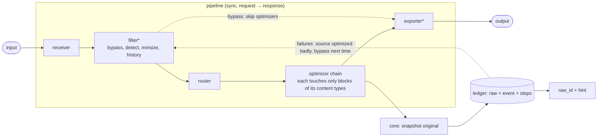

# Flow and payload

## Flow

| Kind | Contract | Role |
|---|---|---|
| receiver | `Run(ctx)`, gets `Settings.Pipeline` | turn input into `Payload`, return the result to the caller |
| filter | `Filter(ctx, p) (Decision, error)` | `Continue` or `Bypass`; may tag attrs |
| router | core, `router.Config` | first matching route picks the optimizer chain, else `default` |
| optimizer | `Optimize(ctx, p) error` | rewrite the payload in place, deterministically |
| exporter | `Export(ctx, p) error` | write or forward the result |
| extension | lifecycle only | shared services; `ledger` implements `component.Ledger` |

- Every component embeds the lifecycle `Start(ctx, Host)` / `Shutdown(ctx)` (`component.Nop` for none).
- Start order: extensions → exporters → optimizers → filters → receivers. Shutdown is reversed.
- Optimizers self-select by `Block.Type` through `payload.Rewrite` (exact types) or `payload.RewriteFamily` (every dialect of a family). The default router therefore
  sends every payload through one chain of all optimizers; routes only override per command or
  content.

## Payload

`payload.Payload{Blocks []Block{Kind, Text, Type}, Attrs map[string]string}`

- **Kind**, where a block came from: `cmd_output`, `tool_result`, `message`, `json`.
- **Type**, what it is: the detected content type, per block (see Content detection).
- **Well-known attrs**: `cmd`, `file`, `url`, `tool`, `mime`, `query`, `session`, `raw`, `raw_id`,
  `route`, `raw_tokens`, `out_tokens`.
- **`Key()`**: stable source identity (`file:` > `url:` > `cmd:` > `tool:`), used for failure history.
