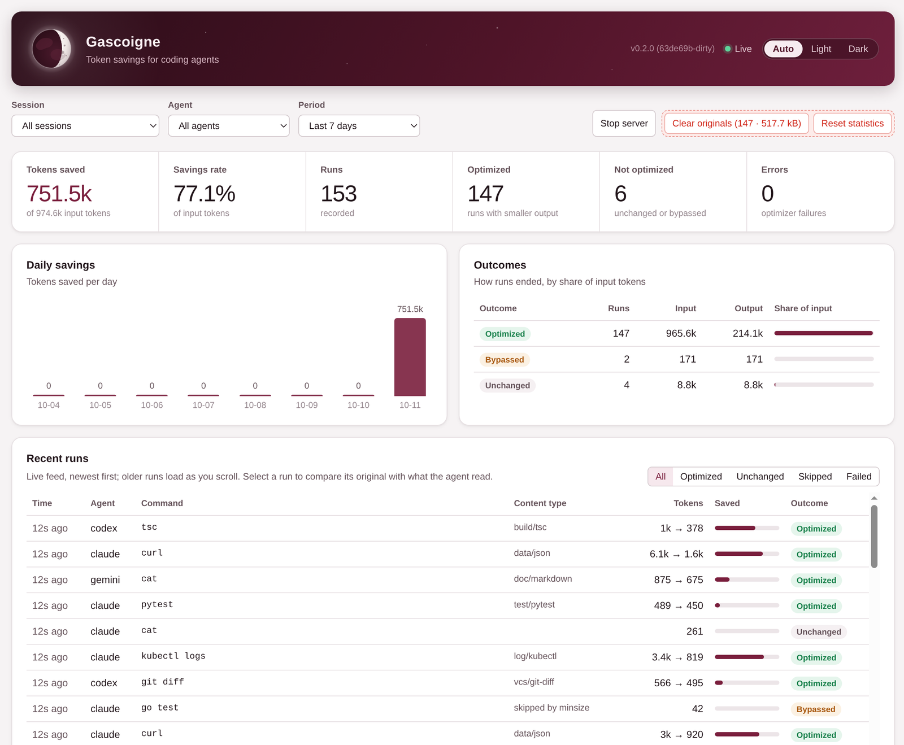

<div align="center">

# 🌘 gascoigne

**Agents read less. Nothing gets lost.**

A token optimizer for coding agents. It shrinks command output, tool results and web pages
before they reach the model, and keeps every original one command away.

`70–99% off verbose output` · `16 families` · `110+ tools & formats` · `claude · codex · gemini · opencode · pi · cursor` · `pure Go, no cgo`

</div>

---

## Start in one line

```sh
go install github.com/gascoigne-ai/gascoigne-cli/cmd/gascoigne@latest && gascoigne wrap claude
```

That's it: Claude Code starts with gascoigne in place for this run. No config files touched;
swap `claude` for `codex`, `gemini`, `opencode` or `pi`. When you like it, `gascoigne install`
keeps it on for the project.

## See it work

Your agent runs the tests and one hangs. Go prints a 421-line goroutine dump (7,478 tokens)
when the 10-minute timeout fires. Here is what the agent reads instead:

```console
$ gascoigne exec -- go test ./sync/
[paths: §1=/home/user/src/shop/sync]
panic: test timed out after 10m0s
	running tests:
		TestSyncOrders (10m0s)

goroutine 52 [running]:

goroutine 1 [chan receive, 9 minutes]:

goroutine 18 [select, 9 minutes]:
example.com/shop/sync.(*Syncer).Run(0xc0001c4000, {0x71c5a8, 0xc0001b6000})
	§1/syncer.go:74 +0x1b8
example.com/shop/sync.TestSyncOrders(0xc0001a69c0)
	§1/syncer_test.go:31 +0x2f1

goroutine 60 [chan receive, 9 minutes]: +39 more on this stack: 61 62 63 64 65 66 67 68 69 70 …29 more
example.com/shop/sync.(*worker).loop(0xc000200000)
	§1/worker.go:52 +0x7c
created by example.com/shop/sync.(*Syncer).start in goroutine 18
	§1/syncer.go:41 +0x9e

goroutine 120 [IO wait, 9 minutes]: +11 more on this stack: 121 122 123 124 125 126 127 128 129 130 …1 more
example.com/shop/sync.(*client).readLoop(0xc0001d2000)
	§1/client.go:118 +0x8e
created by example.com/shop/sync.dial in goroutine 18
	§1/client.go:60 +0x1b5

… 13 standard library frames omitted
FAIL	example.com/shop/sync	600.021s
[gascoigne: optimized 7478→388 tokens · full: gascoigne raw 17415a92]
```

**95% fewer tokens, and the diagnosis is right there:** the test is stuck in `Syncer.Run`,
40 workers wait on a channel receive, 12 clients on network reads. Long paths became `§1`,
identical stacks collapsed, standard-library frames were counted, not printed.

Nothing is thrown away. The original sits in a local ledger, and the agent reads back just what
it needs:

```console
$ gascoigne raw 17415a92 -grep 'goroutine 7[0-9] ' -C 1
95-
96:goroutine 70 [chan receive, 9 minutes]:
117-example.com/shop/sync.(*worker).loop(0xc00020a000)
…
```

And after the fix, the re-run shows only what changed: failures already seen this session
become one line, `[↑ 5 lines as in the previous run, from "--- FAIL: TestParse"]`.

### The dashboard

`gascoigne dashboard` opens a live view in your browser: savings per day, per command and per
optimizer, every run as it happens, and any run's original side by side with what the agent read.

<picture>
  <source media="(prefers-color-scheme: dark)" srcset="docs/images/dashboard-dark.png">
  
</picture>

<sub>The moon's phase is your savings rate: the darker it gets, the more your agents skipped.</sub>

### What it saves

It depends on what your agent runs. gascoigne keeps what an agent acts on (failures, diffs,
errors, anomalies, summaries) and folds the rest, so the more noise an output carries, the more
it removes. Progress bars, passing tests, `managedFields` and pagination tokens go almost
entirely; a source diff or a short search result has little to cut.

| Output | Before | After | Saved |
|---|--:|--:|--:|
| `npm install --verbose` | 24,655 | 76 | **99.7%** |
| nginx access log | 73,148 | 436 | **99.4%** |
| Python `RecursionError` trace | 25,543 | 218 | **99.1%** |
| `go test -json ./...` | 16,208 | 175 | **98.9%** |
| `go test` timeout (goroutine dump) | 7,478 | 388 | **94.8%** |
| `kubectl logs` (JSON) | 23,171 | 2,156 | **90.7%** |
| `aws ec2 describe-instances` | 33,835 | 4,301 | **87.3%** |
| `terraform plan` | 10,663 | 1,697 | **84.1%** |
| `git log` | 4,173 | 1,151 | **72.4%** |
| `cat lib/benchmark.rb` (comments) | 6,390 | 2,800 | **56.2%** |
| `git diff` of source edits | 3,430 | 2,386 | **30.4%** |
| `pytest` with one failure | 899 | 652 | **27.5%** |
| `rg` search | 3,161 | 2,655 | **16.0%** |
| `kubectl get pods` | 675 | 611 | **9.5%** |
| `cat` of a small Go file | 854 | 854 | **0%** |

Across all 268 eval cases the median output shrinks by 69%, and 82% of all tokens go, because
the largest outputs are also the noisiest; 9 cases are left as they are. Outputs under 200 tokens
are passed through untouched. The fixtures are real-shaped samples of the tools gascoigne knows,
so treat them as an upper bound for those tools, not a forecast for your sessions.

**In real use.** Over three days of developing gascoigne itself with Claude Code (over 8,000 tool
results), web pages and API responses read with `fetch` came out 93–99% smaller than the raw
response, `git show` 80%, `go test` 69% and `cat` of source files 38%, while targeted reads such
as `sed -n` ranges and `rg` saved 1–3%. Per coding session, tool output was 4–27% smaller
(median 10%): most of the work was reading and editing code. Tool output is only part of
what the model reads on every turn (system prompt, conversation, your code), so your bill drops
by less than that. `gascoigne gain` shows your own numbers.

<sub>Tokens are a BPE-style estimate, within ~10% of a real tokenizer · fixtures in <code>testdata/eval</code>, <code>make eval</code> · what saved tokens are worth per model: <a href="docs/cost.md">cost</a></sub>

## Install

**With Go** (1.27+), the binary lands in `$(go env GOPATH)/bin`:

```sh
go install github.com/gascoigne-ai/gascoigne-cli/cmd/gascoigne@latest
```

**From a checkout**, into `~/.local/bin` (`PREFIX=…` for elsewhere):

```sh
git clone https://github.com/gascoigne-ai/gascoigne-cli && cd gascoigne && make install
```

Check it: `gascoigne version`. One static binary, no cgo, no services to run: the background
server starts itself when needed and exits after 30 minutes idle.

## Hook up your agent

| Agent | Try it for one run | Keep it on |
|---|---|---|
| Claude Code | `gascoigne wrap claude` | `gascoigne install claude` |
| Codex | `gascoigne wrap codex` | `gascoigne install codex` |
| Gemini CLI | `gascoigne wrap gemini` | `gascoigne install gemini` |
| opencode | `gascoigne wrap opencode` | `gascoigne install opencode` |
| pi | `gascoigne wrap pi` | `gascoigne install pi` |
| Cursor | — | `gascoigne install cursor` |

`install` writes to this project's config; add `-g` for every project, `-proxy` to also route
Claude's API traffic through gascoigne (API key, gateway token or Bedrock API key only: with a
claude.ai login Claude talks to Anthropic directly, see [agents](docs/agents.md#the-llm-proxy-and-a-claudeai-login)). Arguments after the agent name go to the agent
(`gascoigne wrap claude --continue`). `gascoigne unwrap` removes every trace and keeps a backup;
`gascoigne uninstall` also deletes the ledger, config, caches and the binary.

Shell commands then run through `gascoigne exec`, results from other MCP servers are shortened
after the tool ran, and the LLM API proxy trims what the agent's own tools return (Claude's Read
included, line numbers kept).

## Everyday recipes

**Run anything through it**

```sh
gascoigne exec -- go test ./...              # run a command, print optimized output
kubectl get pods -o yaml | gascoigne run     # or optimize anything on stdin
```

**Get the full output back, or just the part you need**

```sh
gascoigne raw af6b9bf6                       # the id from the [gascoigne: …] hint
gascoigne raw af6b9bf6 -grep 'FAIL|panic' -C 2   # only matching lines, numbered
gascoigne raw af6b9bf6 -query "db timeout"   # lines that best match the words
gascoigne raw af6b9bf6 -lines 120-180        # a line range
gascoigne exec -raw -- git diff              # skip optimization for one run
GASCOIGNE_RAW=1 make test                    # or for everything in this shell
```

Agents do the same through the MCP `retrieve` tool (`lines`, `grep`, `query` too). A source whose originals keep getting
fetched is marked as badly optimized and passed through untouched next time.

**Read one function, not the whole file**

```sh
gascoigne show internal/service/pipeline.go             # every definition with its line range
gascoigne show internal/service/pipeline.go:Process     # one function with its doc comment
gascoigne show app/models.py:Cart.total                 # Type.method works too (Go, Python, JS/TS, Rust, Java, C…)
```

**See what you saved**

```sh
gascoigne gain                               # overview: by agent, command, optimizer, cost
gascoigne gain -by day -since 4w             # trend
gascoigne gain -agent codex -by command      # who saves where
gascoigne gain -by command                   # includes system prompt, CLAUDE.md, skills
gascoigne dashboard                          # the same, live, in the browser
```

With the LLM proxy on (`wrap`, or `install -proxy claude`) gain also lists the instruction text
every request carries (system prompt, CLAUDE.md, skill list, invoked skills), text kept for
`gascoigne raw` but not shown in the dashboard,
and the tokens the provider actually billed. Its last section says which numbers are estimates.

**Read the web cheaply**

```sh
gascoigne mcp                                # MCP server: fetch · compress · show · retrieve · stats
gascoigne mcp-proxy -- npx some-mcp-server   # shorten another MCP server's results
```

`fetch` turns pages into markdown and compacts API JSON; pass `query` to keep the sections
that matter. The proxy also trims redundant keys from tool schemas, and with `max_tools: 40`
a server with hundreds of tools shows two (`search_tools`, `call_tool`) to agents without
native tool search.

**Tune it without a config file**

```sh
gascoigne exec -set optimizers.grep.max_per_file=50 -- rg TODO
GASCOIGNE_DISABLE=truncate gascoigne wrap claude   # per agent, via env
gascoigne config                                    # print the effective config
```

Every default lives in `configs/default.yaml`; your overrides go to
`~/.config/gascoigne/config.yaml` (written on first run, every option commented out; after
upgrading gascoigne, `gascoigne config -upgrade` moves your settings onto the new template).

**Housekeeping**

```sh
gascoigne flush -older 7d                    # drop stored originals older than a week
gascoigne reset -since 24h                   # clear recent stats
gascoigne forget <source>                    # re-enable a source that was passed through
gascoigne server status                      # the background server: pid, version, ledger
```

**Count and price text**

```sh
gascoigne tokens README.md                   # tokens per model family, and what they cost
ANTHROPIC_API_KEY=… gascoigne tokens notes.md    # plus exact Claude and o200k counts
```

Exact counts: o200k is counted locally (vocabulary downloaded once); Claude through Anthropic's
free `count_tokens`, key from `tokenizers.anthropic_api_key` in the config or the environment.

## Families

Output is detected as `family/dialect` and handled by one engine per family.

| | |
|---|---|
| **test** | go · jest · vitest · bun · mocha · deno · pytest · cargo · rspec · maven · dotnet · JUnit XML · coverage (lcov, `go tool cover`) |
| **build** | go · tsc · eslint · golangci · ruff · mypy · rustc · gcc · clang · javac · dotnet · vite/webpack · docker · SARIF |
| **pkg** | npm · pnpm · yarn · bun · pip · uv · poetry · go mod · cargo · apt/dnf/brew |
| **task** | nx · turbo · make · just · gradle · compose · CI logs |
| **vcs** | git status/log/diff/blame/branch · gh |
| **search · fs** | grep · rg · ag · git grep · ls · tree · find · du · df · source files |
| **table** | ps · ss · lsof · top · systemctl · docker · any aligned or boxed table |
| **data** | JSON · NDJSON · YAML · CSV · XML · TOML lockfiles · Jupyter notebooks |
| **log** | app · journald · syslog · docker · kubectl · access · CloudWatch · GCP · Azure |
| **doc · web** | markdown · rst · man · `--help` · HTML → markdown · HTTP responses · browser accessibility snapshots |
| **db** | psql · mysql · sqlite · EXPLAIN · redis · mongosh · migrations |
| **k8s · infra · cloud** | kubectl · helm · terraform/tofu · pulumi · ansible · cdk · aws · gcloud · az |

Across families: stack traces fold recursion and goroutines parked on one stack; a test or
build re-run in the same session points at the failures you already saw instead of repeating them.

## Guarantees

- **Lossless by retrieval** — originals go to a local sqlite ledger first; every optimized
  output carries its `raw` id. Output that would save less than its own hint costs is left as is.
- **Deterministic** — same input, same output. Prompt caches stay warm, through the LLM proxy too.
- **Edit-safe source** — source files only lose whole lines (comments, outlined bodies); kept
  lines are byte-exact and every gap names its original lines (`// … comments L12-30`).
- **Self-correcting** — sources whose originals agents keep fetching get bypassed next time.
- **Local** — the ledger and dashboard stay on your machine; nothing is sent anywhere.

## How it works

```
input ─▶ receiver ─▶ filters ─▶ router ─▶ optimizers ─▶ exporters ─▶ output
                                                │
                                   ledger: original · gains · failures
```

Pipeline modeled on the OpenTelemetry Collector: typed components built by factories, wired
by YAML (`configs/default.yaml`). Details in [`.harness/architecture.md`](.harness/architecture.md).

## Documentation

Guides and reference live in [`docs/`](docs/README.md): [getting started](docs/getting-started.md),
[agents](docs/agents.md), [MCP](docs/mcp.md), [CLI](docs/cli.md),
[configuration](docs/configuration.md), [families](docs/families.md),
[source files](docs/source-files.md), [ledger, gain and dashboard](docs/ledger.md), [cost](docs/cost.md),
[architecture](docs/architecture.md), [extending](docs/extending.md).

## Develop

```sh
make check    # gofmt, vet, import boundaries, tests
make eval     # token savings and fact retention on fixtures
```

Contributor and agent rules live in [`.harness/`](.harness/README.md).

## License

[Apache License 2.0](LICENSE).
