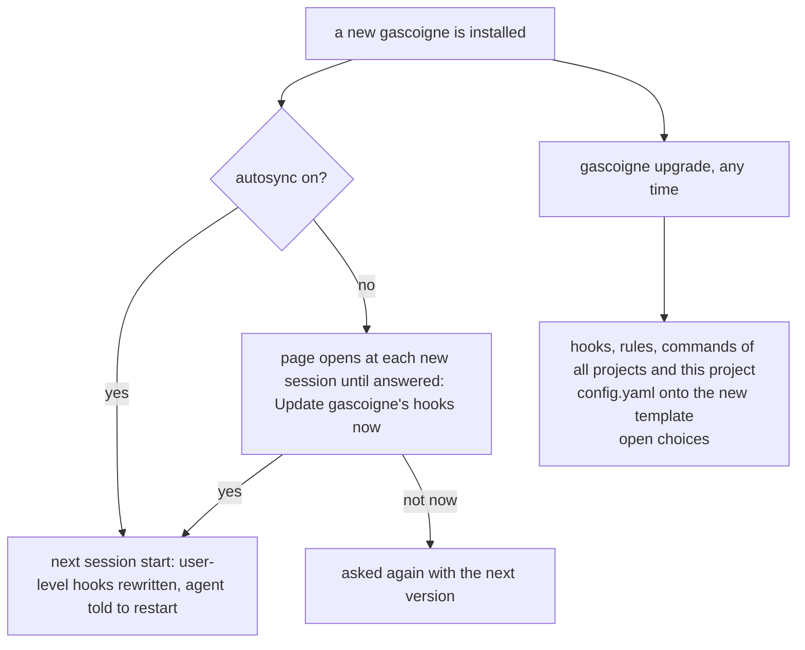
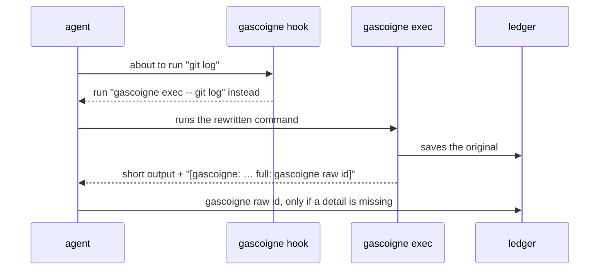

# Agents

gascoigne helps an agent in two ways:

1. **Shell output.** Commands the agent runs go through `gascoigne exec`, or their output is
   optimized after they ran.
2. **MCP tools.** `fetch` reads web pages and APIs compactly, `compress` shrinks any text,
   `retrieve` returns originals, `stats` reports savings. See [MCP](mcp.md).

## Per run: `wrap`

```sh
gascoigne wrap claude [claude args…]
gascoigne wrap codex  [codex args…]
gascoigne wrap pi     [pi args…]
```

`wrap` starts the agent with gascoigne registered for that run only. No config file is
touched. It first makes sure the background server runs and prints the dashboard address. It also sets `GASCOIGNE_AGENT` (the agent name) and `GASCOIGNE_SESSION`
(`<agent>-<date>-<time>`), so every event of the run is tagged and `gascoigne gain` inside the
agent shows that session.

## For good: `install` and `unwrap`

```sh
gascoigne install               # this project: agents found on PATH
gascoigne install claude codex  # this project: named agents
gascoigne install -g            # every project: the user's config files
gascoigne wrap -print claude    # only print the config, to add it by hand
```

| Agent | `install` (project) | `install -g` (user) |
|---|---|---|
| claude | `.claude/settings.json` hook + env, `.mcp.json` | `~/.claude/settings.json`, `claude mcp add --scope user` (else `~/.claude.json`) |
| codex | `.codex/config.toml` | `~/.codex/config.toml` (`$CODEX_HOME`) |
| cursor | `.cursor/hooks.json`, `.cursor/mcp.json` | `~/.cursor/hooks.json`, `~/.cursor/mcp.json` |
| pi | `.pi/extensions/gascoigne.ts` | `~/.pi/agent/extensions/gascoigne.ts` |
| gemini | `.gemini/settings.json` (hooks, MCP) | `~/.gemini/settings.json` |
| opencode | `opencode.json`, `.opencode/plugins/gascoigne.ts`, `AGENTS.md` | `~/.config/opencode/opencode.json`, `plugins/gascoigne.ts`, `AGENTS.md` |

Entries are merged into what is there; a changed file is saved as `<file>.gascoigne-bak`.
Earlier gascoigne entries are replaced, so running `install` again after moving the binary
refreshes them, and an up-to-date file is left untouched. Configs call plain `gascoigne` when
`PATH` finds this binary (project files can then be committed), else its full path. Claude asks
to approve a project `.mcp.json` server on first use; Codex asks to trust the hook (`/hooks`).
Options saved for later installs:

```sh
gascoigne install -permissions local   # claude runs retrieve, show, stats, compress without asking
gascoigne install -guide short         # less usage text for agents (off removes it)
gascoigne install -autosync on         # hooks update installs after a gascoigne upgrade
gascoigne upgrade                      # after installing a new version: hooks, config, open choices
gascoigne setup                        # the same questions, asked in the terminal
```

Nothing that changes how an agent asks for approval, or that updates configs by itself, happens
before you decide: `install` opens a page in the dashboard (`/setup`) with those questions (not
under `CI`, not without a display; `gascoigne setup` asks in the terminal). A coding agent found
on `PATH` without an install is only signaled, once, and set up if you say yes.



**After installing a new gascoigne**, run `gascoigne upgrade`: it writes stale or lost hooks, rules
and commands of your installs again (all projects, and this project; other projects are named),
moves your `config.yaml` onto the new template keeping your settings (the old file stays as `.bak`),
and opens the page for any choice still waiting. `upgrade -n` only lists what would change.
`gascoigne doctor` reports the state without changing anything. With `-autosync on` the user-level
part happens by itself at the next session start; if you did not choose, the page opens at each
new session (at most every ten minutes) until you answer; closing it without saving answers nothing. Claude also gets two commands, `/gascoigne-stats` and `/gascoigne-doctor`, removed by
`unwrap`.

### Release notice

gascoigne's background server reads one small file, `latest.json`, from the project website
(`https://gascoigne-ai.github.io/gascoigne-webpage/`) once a day. When it names a release newer
than the one you run, the next session start opens that release's page once and tells the agent.
The request is a plain GET with no query, cookie or version: nothing about you or this machine is
sent, but the site's host sees your IP address, as for any web page. Hooks never touch the network;
they read the file the server saved. Turn it off in `gascoigne setup` ("Tell me about new releases"),
with `GASCOIGNE_RELEASE_CHECK=off`, or `GASCOIGNE_SERVER=off` (no background server, no check).
`gascoigne doctor` shows the state and the latest release it knows.

### Weekly MCP review

MCP servers add their tool definitions to the agent's tool list, used or not, and most agents send that list with every request (one with its own tool search may send only names). At most once a week, a Claude
session start asks the local background server for the [MCP review](cli.md#mcp-review) and, when
tools nobody called in 14 days cost over 1,500 tokens per request, opens the review page and tells the
agent. Only servers started through `mcp-proxy` count (the others have no sizes). Nothing leaves
your machine and nothing changes unless you choose something on the page: loading the unused tools on
request instead of listing them. A session start opens at most one page: the setup page and the release page
come first, and the review waits for the next start. A compaction or `/clear` is not a session start.
Turn it off in `gascoigne setup` ("Review my MCP servers once a week"), with `GASCOIGNE_MCP_REVIEW=off`, or
`GASCOIGNE_SERVER=off`. `gascoigne mcp-review` shows it whenever you like.

To remove it again:

```sh
gascoigne unwrap                # every agent
gascoigne unwrap claude codex
```

`unwrap` removes exactly gascoigne's entries from user and project configs: Claude settings,
`.mcp.json` and `claude mcp remove`, Cursor hooks and MCP JSON, Codex `config.toml` tables and
the pi extension. Other keys keep their order. The original file is saved as
`<file>.gascoigne-bak`. Files it cannot parse are reported, not rewritten.

`gascoigne uninstall` removes gascoigne entirely: `unwrap` for every agent (user and this
project's configs), stops the server, deletes `gascoigne/` under the config, data (ledger),
cache and state dirs and a ledger kept elsewhere (`$GASCOIGNE_LEDGER`), then the binary. It lists
all of it and asks first (`-y` skips that). Projects installed without `-g` elsewhere need
`gascoigne unwrap` run in them first.

## Savings in the status line

Claude Code can show a command's output in its status line; `gascoigne gain -oneline` prints
`gascoigne: 12.3k tokens saved (45%) ~$0.42` (filters work as for `gain`: `-since 1d`, `-agent`):

```json
{ "statusLine": { "type": "command", "command": "gascoigne gain -oneline -since 1d" } }
```

## Per agent

| Agent | `wrap` passes | How shell output is optimized |
|---|---|---|
| Claude Code | `--mcp-config`, `--settings` | A `PreToolUse` hook on Bash rewrites the command to `gascoigne exec -- <cmd>`. It makes no permission decision, so your permission rules see the wrapped command. |
| Codex | `-c mcp_servers…`, `-c hooks.PostToolUse…` | A `PostToolUse` hook optimizes the output after the run and replaces the result. Codex can only rewrite a command by approving it, so it is optimized afterwards instead. Trust the hook once with `/hooks`. |
| pi | `--extension` (written to your cache dir) | The extension rewrites the bash command through `gascoigne hook pi`. pi has no MCP. |
| gemini | `GEMINI_CLI_SYSTEM_SETTINGS_PATH` to a settings file in your cache dir (your real system settings are merged in) | A BeforeTool hook rewrites `run_shell_command` through `gascoigne hook gemini`; approval stays yours. |
| opencode | `OPENCODE_CONFIG_DIR` (plugin) and `OPENCODE_CONFIG_CONTENT` (MCP servers) | The plugin's `tool.execute.before` rewrites the bash command. Not available when you set `OPENCODE_CONFIG_DIR` yourself: use `install`. |
| Cursor | — (`wrap -print cursor` only) | A `preToolUse` hook returns `updated_input` with `permission: allow`; shell approval stays with `beforeShellExecution`. |

### Results the rewrite cannot reach

Rewriting a command before it runs covers most shell output. What it leaves is optimized after the
tool ran, by replacing the result the model sees:

| Agent | Hook | Covers |
|---|---|---|
| claude | PostToolUse `updatedToolOutput` (same shape as the tool's output) | Bash commands left as they were (pipes, redirects, loops, background runs), Grep in content mode, every MCP server's results (remote, plugin and claude.ai ones included) |
| codex | PostToolUse `decision: block` + `reason` | MCP servers' results (shell output already) |
| gemini | AfterTool `decision: deny` + `reason` | shell commands left as they were, MCP servers' results |

Output gascoigne already optimized (exec, its MCP server, the proxy) is recognized by its hint and
left alone, as are gascoigne's own MCP tools. **Read** is never replaced: Claude numbers the lines
it shows, and dropped lines would shift those numbers. **WebSearch** is left too: its results
(a median of 608 tokens in measured sessions) are rendered by Claude Code from a fixed structure.

### LLM API proxy

What hooks cannot reach (Claude's Read, a quarter of tool-result tokens in measured sessions,
plus WebSearch, subagent results and plans) is shortened between the agent and its API by
the LLM proxy the background server serves under `/v1/` (same process and port as the
dashboard):

| Agent | Per run (`wrap`) | For good |
|---|---|---|
| claude | with `ANTHROPIC_API_KEY` or `ANTHROPIC_AUTH_TOKEN`: `ANTHROPIC_BASE_URL=http://127.0.0.1:7878`; on Bedrock with a Bedrock API key: `ANTHROPIC_BEDROCK_BASE_URL=…/bedrock/<AWS_REGION>`; a base URL you set stays; a claude.ai login stays direct | `install -proxy claude` (same conditions); the SessionStart hook starts the server |
| codex | with `OPENAI_API_KEY`: a `gascoigne` model provider (Responses API); a ChatGPT login stays direct | — |
| opencode | `provider.anthropic.options.baseURL` with an Anthropic key, `provider.openai…` with `OPENAI_API_KEY`; subscription logins stay direct | — |
| gemini | with `GEMINI_API_KEY`: `GOOGLE_GEMINI_BASE_URL`, unless you set one; a Google login stays direct | — |

- **No session.** The proxy sees HTTP requests, and none of the APIs it serves carries the agent's
  session id, so its runs are recorded without one. They show as the "-" group in the dashboard's
  session list and are missing from `gain -session <id>`. The agent and model are still recorded
  (from the user agent and the request body), so `-agent` and `-model` filters and `gain -by agent|model`
  include them, and so does the API usage section. Hook and MCP runs of the same agent do carry the
  session. To read one session's savings in full, add the proxy's runs by agent and time window.
- Only the base URL changes; every header goes through as sent.
- Read results keep their real line numbers: lines are dropped like `cat` output, never
  renumbered, and each gap is a marker naming the lines to read back.
- It also shrinks what is not a tool result but costs the same: tool schemas lose redundant
  keys (`compact_tools`), invoked skill bodies fold long code blocks (`skill_code_lines`), and
  screenshots above `max_image_pixels` (off by default) are downscaled. System prompts, CLAUDE.md,
  the skill list and reminders are recorded with their text, once per distinct block, so `gain
  -by command` shows what instructions cost.
- The proxy also records what each request was billed, as the API reports it in the response
  (input, cache read and write, output tokens per agent and model): `gascoigne gain` shows it
  under API USAGE with list prices, `gain -json` as `api_usage`.
- Each tool result is shortened once and sent byte-for-byte the same on every later request,
  so the provider's prompt cache keeps hitting. Anything the proxy cannot parse is forwarded
  unchanged; `X-Gascoigne-Raw: 1` on a request skips it.
- A result that repeats what an earlier result of the same request shows (a file read again,
  a command run again) has those runs of 3+ lines replaced by one pointer:
  `[↑ L13-18 = L10-15 of earlier Read charge.go]` (a re-read after an edit above them),
  `[↑ 4 lines as in earlier Bash "go test ./..." from "--- FAIL: TestCharge"]`. Only exact
  runs fold (Read lines may shift by a constant), each result depends only on the ones before
  it so earlier bytes never change, and the original goes to the ledger behind the usual hint.
  `fold_min_lines: 0` in `receivers.httpproxy` turns it off.
- `wrap` starts the server when it is not answering and leaves the agent on its API directly
  if it cannot. `GASCOIGNE_PROXY=off` (or `GASCOIGNE_SERVER=off`) turns it off. When the
  server replaces itself with a new build, it first waits until no proxied request is in
  flight. With `install -proxy`, a stopped server stops the agent until the next session
  starts it.
- The server exits after 30 minutes without a request (`GASCOIGNE_SERVER_IDLE`). A
  UserPromptSubmit hook (claude, codex; opencode's `chat.message`) starts it again before the
  agent's next API call, so your next prompt after a break finds the proxy up.

### The LLM proxy and a claude.ai login

With a Claude subscription (Free, Pro, Max: signed in with `/login`, no API key), gascoigne does
**not** put the LLM proxy in front of Claude Code. `wrap claude` prints why and starts Claude
talking to Anthropic directly; `install -proxy claude` refuses. Hooks, `gascoigne exec` and the
MCP server stay on: they never see the credential or the API request, and they produce most of
the savings.

Why: Anthropic's [legal and compliance page](https://code.claude.com/docs/en/legal-and-compliance)
says the subscription login "is designed to support ordinary use of Claude Code and other native
Anthropic applications" and that developers "may not collect, store, or intermediate Claude.ai
credentials or session tokens". A proxy forwards that session token with every request and changes
the request body, which the [gateway guide](https://code.claude.com/docs/en/llm-gateway-protocol)
asks gateways not to do. No sentence names a local proxy a user runs for themselves, but these
lean against it, and Anthropic enforces this area without notice. This is a reading, not legal
advice; ask Anthropic for a definite answer.

| Credential | Proxy for Claude |
|---|---|
| `ANTHROPIC_API_KEY` (Console) or `ANTHROPIC_AUTH_TOKEN` (gateway) | on: gateways are documented for these |
| claude.ai login | off, with a notice |
| claude.ai login and `GASCOIGNE_PROXY=on` | on, at your own risk |
| `GASCOIGNE_PROXY=off` | off for every agent |

Every agent follows the same rule: the proxy only sees API-key traffic, never a subscription
login.

| Agent | Proxy with | Stays direct with |
|---|---|---|
| claude | `ANTHROPIC_API_KEY`, `ANTHROPIC_AUTH_TOKEN`; Bedrock API key (`AWS_BEARER_TOKEN_BEDROCK`) | claude.ai login; Bedrock with AWS credentials (SigV4 signs the body); Vertex, Foundry; your own base URL |
| codex | `OPENAI_API_KEY` | ChatGPT login |
| gemini | `GEMINI_API_KEY` | Google login |
| opencode | Anthropic key; `OPENAI_API_KEY` | Claude or ChatGPT subscription logins |
| pi, cursor | — (no proxy) | — |

**Claude on Amazon Bedrock.** Bedrock is billed under your AWS agreement and Anthropic documents
gateways for it. With `CLAUDE_CODE_USE_BEDROCK=1`, `AWS_REGION` and a Bedrock API key
(`AWS_BEARER_TOKEN_BEDROCK`), `wrap claude` sets `ANTHROPIC_BEDROCK_BASE_URL` to
`http://127.0.0.1:7878/bedrock/<region>`; the proxy shortens tool results like for the Anthropic
API and forwards to `bedrock-runtime.<region>.amazonaws.com` (`receivers.httpproxy.bedrock`, a
template with `{region}`, e.g. for a VPC endpoint). With AWS access keys or SSO instead, each
request is SigV4-signed over its body, so a changed body would be rejected: Claude stays direct.
API usage is not metered on Bedrock (its responses are a binary event stream).

### Claude Code: built-in search and fetch tools

`wrap claude` and `install claude` deny **Grep**, **Glob** and **WebFetch**: Claude then searches
with `rg` and `find` through Bash, where the rewrite optimizes them fully, and reads pages with
gascoigne's `fetch`, whole and compressed, where WebFetch hands back a small model's retelling of
the page. **Read** stays: Edit refuses to change a file Read has not loaded. `install` records the
rules it added (`$XDG_STATE_HOME/gascoigne/denies.json`, and `allows.json` for `-permissions`), so
`unwrap` removes those and keeps rules you wrote yourself.

## Usage guide for the agent

Agents are told how to get the most out of gascoigne: read and search with shell commands,
keep shell calls plain (`&&`/`;` lists, only `| head`/`| tail`), read the web with `fetch`, and
use `gascoigne raw <id>` / `retrieve` (or only part: `-grep`, `-query`, `-lines`) instead of
re-running a shortened command, read one function with `gascoigne show file:Name`, and keep
their own text brief (in an A/B run that cut output tokens 16% at the same success rate), and
issue independent tool calls together in one turn, since every extra turn re-reads the whole context
(not measured yet: compare requests per session before and after on your own ledger).

| Agent | `wrap` | `install` | `install -g` |
|---|---|---|---|
| claude | `SessionStart` hook (`additionalContext`; again after compaction and `/clear`) | same hook in `.claude/settings.json` | in `~/.claude/settings.json` |
| codex | `-c developer_instructions` (skipped when you set your own) | marked block in `AGENTS.md` | in `~/.codex/AGENTS.md` |
| cursor | — | rule `.cursor/rules/gascoigne.mdc` (`alwaysApply`) | none: Cursor keeps user rules in its settings |
| pi | — | marked block in `AGENTS.md` | in `~/.pi/agent/AGENTS.md` |
| gemini | SessionStart hook | same hook in `settings.json` | same |
| opencode | `instructions` file (skipped when you list your own) | marked block in `AGENTS.md` | in `~/.config/opencode/AGENTS.md` |

The `AGENTS.md` block sits between `<!-- gascoigne:start -->` and `<!-- gascoigne:end -->`;
`install` replaces it, `unwrap` removes it (and deletes the file when nothing else is in it).

## Other MCP servers

Every other stdio MCP server the agent has is started through `gascoigne mcp-proxy`, so its
tool results are optimized too. `{"command": "npx", "args": ["-y", "srv"]}` becomes
`{"command": "gascoigne", "args": ["mcp-proxy", "--", "npx", "-y", "srv"]}`; env and other keys
stay, and the original command stays in `args`, so `unwrap` restores it exactly.

| Agent | `wrap` (this run) | `install` |
|---|---|---|
| claude | same-named copies in `--mcp-config`, which replace the configured ones for the run (plugins and claude.ai connectors keep loading). User, local and approved `.mcp.json` servers; disabled or unapproved ones are not started | `.mcp.json` and this project's local servers in `~/.claude.json`; `-g` the user's servers in `~/.claude.json` |
| codex | `-c mcp_servers.<name>.command/args` overrides | `config.toml` tables rewritten |
| cursor | — | `mcp.json` rewritten |
| gemini | proxied copies in the run settings (system scope wins) | `settings.json` `mcpServers` rewritten |
| opencode | proxied copies in `OPENCODE_CONFIG_CONTENT` | `opencode.json` `mcp` commands rewritten |

Remote servers (`http`, `sse`, `ws`, `url`) are listed as *left direct*: their auth (OAuth,
headers) belongs to the agent. Plugin servers and claude.ai connectors cannot be proxied.
Claude Code keeps `~/.claude.json` in memory and writes it back, so run `install` for claude
with no Claude session open.

## How a command is optimized



## Which commands get rewritten

The hook rewrites every command it can rewrite safely:

- **Attribution.** Under `wrap`, `GASCOIGNE_AGENT` and `GASCOIGNE_SESSION` tag every run. Hooks
  installed for good (`wrap -print`) have no such environment, so the rewritten command carries
  them: `gascoigne exec -agent cursor -session <hook session> -- …`. Runs from a terminal or a
  script have no agent; the dashboard shows them as *no agent*.
- **Any program.** Unknown tools and scripts are wrapped too (`./report.py --json`): their output
  is detected by content (JSON, logs, tables, see [Families](families.md)). Left out: shell
  builtins (`cd`, `export`, `source`: they must change the agent's shell), commands that print
  little (`echo`, `mkdir`, `rm`, `mv`, `cp`, `chmod`, …: they would only add bypassed runs to
  the stats), editors and pagers, and REPLs started without arguments (`python3`, `psql`).
- **Lists.** In `a && b` and `a; b` every command is wrapped, each with its own hint:
  `cd api && go test ./...` → `cd api && gascoigne exec -- go test ./...`;
  `git status; git log -5` → `gascoigne exec -- git status; gascoigne exec -- git log -5`.
  Lines with loops, conditionals or `{ }` groups are left whole.
- **Environment.** Leading assignments stay outside: `CGO_ENABLED=0 gascoigne exec -- go build`.
- **`2>&1`** is kept; exec merges stderr anyway.
- **`| head` / `| tail`.** Trailing head/tail stages are kept and cut the optimized text. Before
  `head`, exec prints its hint first (`-attr hint=top`) so the cut keeps the retrieve id.
- **Left alone:** other pipes (`| grep` would search optimized text), redirects, `$(…)`,
  backticks, `||`, background runs (`&`, `run_in_background`), multi-line scripts, commands
  that run gascoigne itself or set `GASCOIGNE_RAW`, and commands that run until stopped:
  `-f`/`--follow` on logs, `--watch`, `watch`, `dev`, `serve`, `start`, `up`, plain `vite`.
- **Build tools in watch mode** (`tsc -w`, `webpack --watch`, `webpack serve`, `vite build
  --watch`, rollup, esbuild) run as `gascoigne exec -watch -- …`, also in the background: each
  rebuild is printed, optimized, as soon as its result line (`Found 2 errors. Watching for file
  changes.`, `webpack … compiled …`) appears.

## Reading results as an agent

Optimized output ends with (or, before `head`, starts with) a hint:

```
[gascoigne: optimized 4120→610 tokens · full: gascoigne raw <id>]
```

- Need the full text? `gascoigne raw <id>`, or MCP `retrieve` with the id.
- Need one command verbatim? `gascoigne exec -raw -- <cmd>` or `GASCOIGNE_RAW=1`.
- Source files show gaps as comments naming line ranges; read a range with `sed -n 12,30p f`,
  which is small and passes through untouched. See [Source files](source-files.md).

Fetching an original teaches gascoigne that the source needed more, so the next run of the
same command, file or URL passes through untouched.

## Tuning per agent

No config file is needed: set flags in the wrapped command or environment in the agent.

```sh
GASCOIGNE_SET='optimizers.grep.max_per_file=30' gascoigne wrap claude
GASCOIGNE_DISABLE=cat gascoigne wrap codex     # leave source files alone
```

See [Configuration](configuration.md).

## Watching it work

```sh
gascoigne dashboard
```

shows every run as it happens, with the agent, command, content type, savings and, for runs
that were not optimized, why. See [Ledger, retrieval and gain](ledger.md#dashboard).
