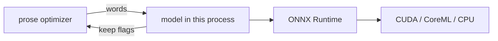

# Prose compression with a local model

Experimental and off by default: `experimental: [prose]` in the config (or `GASCOIGNE_EXPERIMENTAL=prose`) turns it on, once `gascoigne prose install` has fetched the model. Drops low-value words from prose (`doc/text` and plain markdown paragraphs, including converted web pages) with
a ModernBERT extractive compressor (see Attribution).
Lossy: the original stays retrievable with `gascoigne raw <id>`. Numbers, paths, flags,
identifiers, negations, inline code and links are never dropped; headings, tables, lists, quotes
and code fences are untouched.

The model is loaded inside the process that optimizes, with no cgo and no separate program. The background
server keeps it loaded between runs, so runs that go through the server (the default) pay the load once. A run
that stays local (`GASCOIGNE_SERVER=off`, another build, or a `GASCOIGNE_*` variable such as
`GASCOIGNE_EXPERIMENTAL`; use the config setting to avoid that one) loads it for itself.

## Setup

1. `gascoigne prose install` downloads ONNX Runtime 1.29 for your platform and the model (601 MB),
   both hash checked, into the user cache dir (`-model DIR` to change it). `-runtime
   auto|cpu|cuda12|cuda13` picks the ONNX Runtime build; auto reads the CUDA version from
   `nvidia-smi`, and macOS has no GPU variant (CoreML is built in). A CUDA build also needs the
   CUDA runtime and cuDNN 9 on the library path; it falls back to the CPU when they are missing.
2. Enable it: `experimental: [prose]` (or `gascoigne setup`). The server loads the
   model at start (`optimizers.prose.warm`), so the first request does not wait for it.

Status: `gascoigne prose status` and the dashboard (*Experiments* panel, shown when any experiment is on) say `off`, `not-installed` or `ready`. The pass has its own optimizer id, `prose`, so its savings are the `prose` row of
`gain -by optimizer` and of the *By optimizer* tab; the Experiments panel adds them to the model's state.

Device: `optimizers.prose.device`, `auto`, `cuda`, `coreml` or `cpu`. Auto tries CUDA
(Linux, Windows) or CoreML (macOS, which uses Metal and the Neural Engine; ONNX Runtime has no
direct Metal provider), then the CPU. The chosen device shows in the debug log.

A missing or failing model never fails a command: prose stays as it was, and after three failures
the model is not tried again until the server restarts. A native fault in the runtime is caught the same way.
The same text can score slightly
differently on GPU and CPU.

Command output with aligned columns (`ps`, `df`, `ls -l`), headings, lists and gascoigne's own
omission markers are never sent to the model.

## Checksums

`install` prints each file's SHA256 and refuses a download that differs. The ONNX Runtime 1.29.0 archives (from github.com/microsoft/onnxruntime/releases/tag/v1.29.0, hashes as GitHub lists them):

| platform / build | archive | sha256 |
|---|---|---|
| linux/amd64/cpu | `onnxruntime-linux-x64-1.29.0.tgz` | `c3fddc4f139a045b0c4902c57410f0694f1c2fdf9b6939fbe38b1aeae7cd14ba` |
| linux/amd64/cuda12 | `onnxruntime-linux-x64-gpu_cuda12-1.29.0.tgz` | `4ca594a0da83927befbd73fe020d7f569be151d70bb4fe9741ad405f4882e2ad` |
| linux/amd64/cuda13 | `onnxruntime-linux-x64-gpu_cuda13-1.29.0.tgz` | `844c64acfc43ab9423215c26493055ea229268e28283146cc644ecef0bdae048` |
| linux/arm64/cpu | `onnxruntime-linux-aarch64-1.29.0.tgz` | `e1799098ebc054b370f6176a450f158720f297818c613e5dc99b92e2ec82346f` |
| darwin/arm64/cpu | `onnxruntime-osx-arm64-1.29.0.tgz` | `d0706fc34f315d8c88639d0a8c81f2e09e815f282cabed3493c06a054352cf92` |
| windows/amd64/cpu | `onnxruntime-win-x64-1.29.0.zip` | `c9b4b7086b529ad814f428c1bad028e20a25d7dc0699836775faace4ab5b78b2` |
| windows/amd64/cuda12 | `onnxruntime-win-x64-gpu_cuda12-1.29.0.zip` | `3526773ba1fef5849a3e9d18558d87bbbb75b0db3ddcde4f08694a746ac3169f` |
| windows/amd64/cuda13 | `onnxruntime-win-x64-gpu_cuda13-1.29.0.zip` | `0d2ab3feb9ed0ae68ccbbf2013ac87ad58a3b31bc8b28c5854f2ccacecbd8d90` |
| windows/arm64/cpu | `onnxruntime-win-arm64-1.29.0.zip` | `a094a49c3ced0f9fca554647cc7566ae99d93a63a8ce6bf47975561c2de7608e` |

Model files, at revision `e00cc5e60ff73b01674ef8fa6da6c5acf6d54181`:

| file | sha256 |
|---|---|
| `tokenizer.json` | `6c8aaa9a542084f2457eab775d4eeb51f92a70c0fd9de28d5edb0ddec3c08d30` |
| `onnx/kompress-fp32.onnx` | `0f6758d903b5b5b90f784b7f17b599277f040a3c268afb88c193fe5bb9c08649` |

macOS on Intel has no ONNX Runtime 1.29 build: use `-lib` with your own.

## Attribution

Model: [chopratejas/kompress-v2-base](https://huggingface.co/chopratejas/kompress-v2-base),
Apache 2.0, fine-tuned from ModernBERT-base (Apache 2.0). Downloaded by `gascoigne prose install`
at a pinned revision; not bundled with gascoigne.
